# CTF workshop series: plan

Status: **draft 4, 2026-10-12.** The range, all 14 attack-ladder targets, all five session packs and the CTF-5 defend
tooling are built; the wall of shame, bonus flaw, scoring, one-page SOC and student SIEM view are on `main`. What is
left is listed under "Where it stands" below. What was
built and how it was verified is in [`RELEASES.md`](../RELEASES.md) ("CTF range build log"). The spike answers and the
decisions log (CTF-S1..S17, CTF-D1..D26) are in [`CTF-SPIKES.md`](CTF-SPIKES.md), a companion file to this one.
Sections 1-13 below are the design; where the build deviated from them, the section carries a note.

---

## Where it stands (2026-10-12)

**Built:**

- **Range and control plane:** `ctf-host` (boxed DinD, per-pack scoped images, CTF-D26), `ctf-controller` (slot
  reconcile for CTF-5, start/stop/reset queue for CTF-1 to CTF-4), `ctf-builder` + in-lab registry (the defend loop,
  83s push-to-redeployed), `ctf-flags` + `dojo-flag`, per-uid isolation, Target Viewer (`ctf-view`), Lab Info library.
- **Targets:** all 14 (rows 0-14 of section 7.3), each with a README and a reference `exploit/solve.py`. Rows 8, 10
  and 11 have no image: they are seeded by hooks (Forgejo repos, an OpenBao AppRole, a CI workflow).
- **CTF-5 pressure layer:** attacker-bot swarm on one shared clock, SOC feed, cyber map, red/yellow/green status
  light, MTTP, incident summary, inject and hint probes, wall of shame (minimal slice).
- **Packs:** `ctf-access` (CTF-1, targets 0-3), `ctf-server-trust` (CTF-2, targets 4/7/12/13), `ctf-secrets-config`
  (CTF-3, all 3 of its targets: `leaky-config`, `git-secrets`, `tfstate-treasure`), `ctf-trust-chain` (CTF-4, all 3:
  `dns-resolver-cve`, `policy-bypass`, `runner-escape`), `ctf-defend` (CTF-5). The old shared `ctf-defend-test` harness
  is deleted; every pack is tested on its own now. `ctf-secrets-config` and `ctf-trust-chain`'s moved hooks
  (`tfstate-treasure`, `runner-escape`) are live-verified end to end on their own cold starts (RELEASES.md).

**Added 2026-10-09 to 2026-10-10 (merged to `main` as PR #23, `feat/ctf-wall-and-bonus`; the SIEM work landed in commit
`0524b2d`):**

- **Wall of shame (8.12):** `/ctf-wall` on `ctf-controller`, `CTF_WALL_OF_SHAME` (module default off, `ctf-defend` on),
  its own identity-gated route plus a facilitator tab. Live-checked: page 200, `/ctf-wall/config`, three LIVE rows.
- **Bonus second flaw (8.7, CTF-D17) for `customer-portal` only:** cleartext password storage, `CTF_BONUS_FLAWS`
  (default on). Off means a clean repo, no bonus CI step, no `c1` challenge, no lab mention, bots skip data-at-rest
  probes. A "Gate premise" CI step stops a hashing-only fix passing the main gate. Live-checked on a real PR:
  premise step passes, `bonus_check` informational, merge redeploys, target goes yellow (breached then fixed).
- **Scoring (8.10):** green 10 / yellow 5 / red 0 (x`CTF_SCORE_FACTOR`, default 5 units of 2/1/0), plus 5 for the
  bonus only after the main gate is green. First-blood and class-clear are off for `ctf-defend` so the arithmetic is exact.
- **One-page SOC:** map, alerts and incident summary on one screen (`/achievements/soc`; `/map` and `/incident`
  redirect). Offline Natural Earth world map with a Canada inset; attacker origins are ISO country codes (CN, US, RU,
  UA, NG, ZA, BR, AR, AU, AE, IR, TR, IN, VN) shown as unlabelled glints. Student regions come from the forwarded
  client IP via an optional offline DB-IP database (`modules/achievements/tools/fetch_geoip.sh`, not run yet); no
  database, a private IP or WSL falls back to `CTF_HOME_REGION` (Toronto). Raw IPs are never stored.
- **Test clock:** `./dojo <pack> --test` sets `CTF_TIME_SCALE=0.1` (dwell 48s, ramp 60s). Override with
  `CTF_TIME_SCALE=1`. The wall's 90s LIVE window and age-off are not scaled.
- **Student SIEM request log:** log-line feed (time, country, method,
  path?query, status, bytes, detection tag) expandable to JSON; bots emit scan noise, probes and the real exploit
  (`attacker-bot/traffic.py`); `CTF_SIEM_DETAIL=full|paths|off`; spoiler control (payload, size and JSON unlock only
  after that student's own target is red, enforced server-side). Live-checked as facilitator: exploit shows
  `GET /search?q=...`, 200, 873 B, 6 rows, "bulk data egress".
- **Attack Range tab moved:** it now lives in the manifests of the four attack packs, not the `ctf-range` module, so
  `ctf-defend` has no dead tab (it gets a "Range Controller" status check instead).
- **`./dojo` CLI additions:** `test`, `exec`/`shell`, `urls`, `open`, `wait`, `version`, `roster`, `reset-student`,
  `export-results`, `backup`/`restore`, `prune`, `validate`, `doctor --fix`, `status --watch`, `logs --all/--since/
  --grep/--errors`, `--json` on list/modules/doctor (`docs/cli-reference.md`).

**Added 2026-10-11 to 2026-10-12 (on `main`):**

- **Stable image tags with input reuse** (`feat/tag-consolidation`, fast-forwarded into `main`). `dojo` fingerprints
  each Compose build's context and options into a `dojo.src-hash` label and retags a matching image from another
  workshop instead of rebuilding it (details in `RELEASES.md`, "Stable image tags with input reuse"). The merge
  needed three fixes, all found by the first live start, none by the unit tests or `--dry-run`:
  - `ctf-host`'s `skopeo` pin had been swapped for a digest quay.io does not serve (`manifest unknown`); restored.
  - With achievements on, `docker-compose.achievements.yml` `extends:` the `ctf-defend` override, and Compose then
    resolves the attacker-bot's relative build context against the override's folder, not `engine/`. The context is
    now `${CTF_RANGE_CONTEXT:-../modules/ctf-range}`, set absolute in `workshop.env` for that case.
  - `${CTF_DEFEND_OVERLAY_FILE:?}` aborted `./dojo stop`, which loads no `workshop.env`; it now has a default.
  Lesson for any overlay that uses `extends:`: relative paths resolve against the extended file, and `--dry-run`
  does not exercise a build.
- **Removed:** `feat/ctf-wall-and-bonus`'s last commit (`e390cc3`) only commented out `.github/workflows/ci.yml`; it
  was dropped, not merged. Three Dependabot Flask 3.0.3 to 3.1.3 branches were deleted unmerged, so the targets and
  the `ctf-defend` sample repo are still on `Flask==3.0.3` (a deliberate pin for teaching targets; test before
  bumping).

**Handoff: pick up here (updated 2026-10-12):**

1. **Verified live 2026-10-12, locally:** `./dojo ctf-defend --test 3 --fast` after the fixes above: 20 services
   healthy, three `~/.dojo-bot-done` markers, `./dojo logs --errors` clean, `./dojo stop` removed everything,
   `./dojo validate` clean for all packs. The full unit suite last passed on the tag-consolidation branch before the
   three fixes; those touch only a Dockerfile, a compose fragment and `workshop.env`.
2. **Swarm and SIEM live test passed 2026-10-12, locally:** Start Attack Swarm (`POST /achievements-admin/api/soc/start`,
   class logins `admin`/`admin` and `student`/`student` under `--test`) ran green, yellow, red with about 130 alerts.
   A student saw only their own persona's rows; `CTF_SIEM_DETAIL=paths` and `off` stripped detail for students and
   not for the facilitator; `CTF_BONUS_FLAWS=off` gave a clean seed repo; logs clean. Small observation: after a
   restart of `achievements` alone the SOC timer resets to "waiting" while the stored rows stay and `unlocked` is
   still true.
3. **Never live-tested:** the geo database path (run `fetch_geoip.sh`, check `X-Forwarded-For` through Caddy, WSL
   always shows private so it falls back), `dojo test`, `backup`/`restore`, `doctor --fix`, a real `reset-student`,
   `status --watch`, `CTF_TIME_SCALE=1` full-length run, (the other four CTF packs were started under
   the new tag scheme on 2026-10-12, see item 7).
4. **Decisions still open:** (a) bonus flaws for targets 8-11 would need those targets added to `ctf-defend` as extra
   repos, a bigger change than "second flaws"; (b) the live slot before a student's first merge is built from
   `targets/customer-portal` and always stores cleartext passwords, so with the bonus off the live dump still shows
   cleartext until their first redeploy (fix: env passthrough in `ctf-controller._env_for`); (c) `/achievements/wall`
   is still reachable when the wall toggle is off; (d) wall rows carry no dumped-record payload; (e) the bonus
   appears as a challenge titled "Second Look" when on; (f) the pre-breach `full` SIEM detail equals `paths`, and
   bonus-path probes are synthetic 404s whatever the real app answers.
5. **Housekeeping done 2026-10-12:** `RELEASES.md` has an entry for the wall, bonus flaw, scoring, one-page SOC,
   SIEM view and the new CLI commands, and the `ROADMAP.md` row no longer lists the wall toggle as unbuilt.
6. **Observed live:** breach rows only appear at most once per 15s x scale per student; the student bots in
   `ctf-defend` do not open fix PRs, so a bot run only exercises the attack side (a PR was driven by hand for the CI
   path).
7. **Other four packs started 2026-10-12, locally** (`--test 2 --fast`, one at a time, each stopped after): `ctf-access`
   15/15 healthy, `ctf-server-trust` 15/15, `ctf-secrets-config` 21/21, `ctf-trust-chain` 19/19; every pack got both
   bot-done markers. Logs were clean except `ctf-secrets-config`: `openbao-server`
   logged 5 `[ERROR]` lines in one second at start-up (`failed to audit request/response: path=auth/token/lookup-self`,
   `error fetching salt: failed to persist salt: cannot write to readonly storage`). A rerun the same day reproduced it
   identically: the file audit device is enabled while raft is still read-only, so setup's first `lookup-self` is
   not audited; the device re-enables a second later and `audit.log` then held 129 entries. A start-up race, not a
   permission problem and not related to the tag scheme; it costs one unaudited setup call and makes
   `./dojo logs --errors` report this pack as noisy. Not fixed.

**Done 2026-10-13 to 2026-10-14 (PRs #28, #29, #30):**

- **Debriefs and hint ladders (PR #28):** every attack lab has a debrief; `ctf-defend` lab 1 has a two-step hint
  ladder (SIEM log pattern, then the code path) and a debrief. `git-secrets` is tied to CWE-798 rather than forced
  into the OWASP Top 10.
- **Discoverability audit (PRs #29, #30):** see the rule in "Facts to keep in mind". Targets surface existence and
  shape (landing pages, `GET /spec` on `api-mass-assignment`, `api-bfla` and `policy-bypass`, errors that name what
  they expected), labs state required facts in the step text, each CTF cheat sheet has three core-command slides,
  and Lab Info has a `curl` primer. Flaws, flags and `solve.py` are unchanged.

**Defend lab redesign (decided with the user 2026-10-14; built on `feat/ctf-defend-three-targets`, live verification pending; as-built contract in 8.13):** `ctf-defend` becomes three live targets per
student at once, attacked in a per-student order, and the bonus second flaw (8.7, CTF-D17) is dropped.

- **Shape:** three targets up at once per student, the lab as incident triage ("a mess") rather than the sequential
  attack-then-next shape of the attack packs. Reuse the target apps and exploit checks from the attack packs; write one
  new defend lab (briefing, per-target hint ladders, per-target and overall debrief).
- **Attack order:** six permutations of three targets, dealt to students deterministically from a per-run seed, so
  student01 is not always 1-2-3 but a given run is reproducible and roughly balanced (about 3-4 per permutation for 20
  students). **Time-driven:** each target's attack starts on a dwell timer inside a global timebox, not when the
  previous target is fixed, so unfixed breaches pile up. A ceiling stops a stuck student drowning.
- **Where the order lives:** recommended in `ctf-controller` (computes and stores `student -> [(target, start)]`),
  with the swarm bot executing its row, because scoring, the facilitator view and the SIEM all need the same
  schedule. Not yet verified against the controller code; ask before any `engine/` change.
- **Signals:** each target shows a different kind of signal in the SIEM (request log, auth or audit events,
  pipeline or repo events), because finding the signal is the defender's job. Plus some benign-but-noisy traffic.
- **Severity:** low, medium and high, all exploitable, so any breached target shows the red "exploited" banner on the
  wall. Severity is impact, not difficulty: every fix is a small diff (about 10 lines).
- **Scoring:** per-target time to contain, summed. The severity weight belongs to the target, and each target's clock
  starts at that target's own breach time, so the order a student happens to get does not change fairness.
  Suggested 3 / 2 / 1 for high / medium / low.
- **Loop:** detect, triage, contain, fix, verify, stated in the Lab Info preamble. No `INCIDENT.md` gate (decided
  against with the user, 2026-10-15: the PR gate is advisory and the presence-only check added nothing a reviewer
  couldn't tell from the diff — built, then removed, see below). Containment stays an optional separate step.
- **Toolset:** git, an editor, `python3`, `curl`, the exploit check and the SIEM panel; no scanners, no internet.
- **Class size:** about 20 students for this lab (about 60 slots); more than that becomes two workshops.
- **Decided 2026-10-14 (second pass):**
  - **Targets and severity:** `customer-portal` high, `policy-bypass` medium, `leaky-config` low. `git-secrets` is a
    stretch target only if a rotation mechanism proves out (its fix is operational, not a code diff).
  - **Identity for `policy-bypass` (option B):** a small proxy in front of each target sets a caller identity the way
    Caddy does for the platform; the app trusts that, never the request-body tag. The checker's positive test sends a
    legitimate security-team request through it.
  - **`dojo check`:** a terminal command that asks a server-side checker to run all three exploit checks against the
    student's live slots and prints a verdict per target (`still exploitable` / `contained` / `unreachable`), never a
    payload or row count. Exploit scripts are not student-readable (they live in the checker image, like the attacker
    bot's), and each check also sends one legitimate request so "contained" means "blocked and still usable". The PR gate
    uses the same checks. Light rate limit only.
  - **Signals must be strong indicators:** each target emits a signal that is specific, countable and separable from
    the benign noise (see the per-target signal table once written). Still to define per target.
  - **Still to decide:** the stagger interval (from a pilot; start near half the median fix time).
- **Build map:** superseded by the as-built contract in 8.13 (controller, builder, checker, bot, SIEM and pack all
  under `workshops/` or `modules/`, no `engine/` edit).

**Session 2026-10-14 evening — scorecard, demo bots, one engine fix (uncommitted, branch `feat/ctf-wrapup`, pick up here):**

Nothing below is committed. `git status` on `feat/ctf-wrapup` has: `ROADMAP.md`, this file, `engine/docker-compose.yml`,
`modules/achievements/{README.md,service/server.py,service/store.py,service/static/soc*.{html,js}}` (scorecard),
`modules/achievements/service/test_scorecard.py` (new), `modules/ctf-range/targets/ssrf-fetcher/app.py`, and new
`workshops/{ctf-access,ctf-server-trust,ctf-secrets-config,ctf-trust-chain}/content/bots/` directories.

- **End-of-session scorecard, built (closes "Open" item 3 below, 8.10/CTF-D19):** `store.py`'s `scorecard(user)` /
  `admin_scorecard()`, routes `GET /api/scorecard` and `GET /achievements-admin/api/scorecard`, a "Scorecard" section
  on `soc.html`/`soc-admin.html` (`textContent` only). Unit-tested (227 tests pass). Live-checked: the admin route
  returns 200 with correct `factor: 5` on a real `ctf-defend --test` stack; lights were all zero because the demo
  bots there only run the generic git workflow, which is expected. The student-side route was **not** curled live —
  reading the student password out of `.env` to log in as one is credential handling, out of bounds for an
  agent/session to do itself; a human needs to do that check.
  - **"Arithmetic mismatch" closed 2026-10-15 -- not a bug, already the design.** The scorecard
    (`_card()`/`scorecard()`) totals units × target weight (3/2/1) × `CTF_SCORE_FACTOR`, but that weight only ever
    exists for `ctf-defend`'s three targets: `target_meta`'s `weight` is set only by `adapter()` from a `ctf`/`soc`
    event carrying `target_severity`/`weight` (the defend swarm/checker), and no other pack's achievements catalog
    has a `weight` field at all (checked: `rg -l weight workshops/*/achievements/catalog.json` returns only
    `ctf-defend`'s). The milestone ledger (`d-patched`/`d-unbreached`) pays a flat `ACHIEVEMENTS_MILESTONE_POINTS`
    per milestone deliberately, already documented in `ctf-defend`'s own `ACHIEVEMENTS.md`/`catalog.json` intro:
    "milestones use the house default, kept small on purpose, since CTF-5 is a cooperative incident, not a
    leaderboard race... Scoring weights (3/2/1) are applied by the SOC scoring, not here." The scorecard is the
    severity-weighted track; the leaderboard is the flat participation track; they were always meant to disagree.
    No code change made.
- **`customer-portal` catalog/page check (closes item 4 below):** confirmed via `rg` it is in no attack pack's
  `CTF_ATTACK_TARGETS`/manifest/lab content. Landing-page template has no request-data interpolation (no XSS); no
  other issues found.
- **`ssrf-fetcher` 500 fixed:** previewing its own port (`127.0.0.1:5000`, which the lab's own hint points a student
  toward) made the single-threaded Flask dev server fetch itself while already busy handling that very request, so
  the fetch always timed out and the uncaught `socket.timeout`/`OSError` 500'd. Added `OSError` to the caught
  exceptions; verified offline with Flask's test client (self-preview no longer 500s, the real exploit still returns
  the flag).
- **Demo bots for the four attack packs, written** (`content/bots/steps.sh`, closes most of item 5 below): each bot
  drives `/ctf-attack/attack/{start,status,stop}` via `bot-runner.sh`'s `portal_login`/`portal_curl`, runs the lab's
  own taught technique with curl/python3/jq, and calls `dojo-flag submit`. `ctf-secrets-config`'s and
  `ctf-trust-chain`'s bots correctly skip `git-secrets`/`tfstate-treasure`/`runner-escape` with a clear message — those
  targets' seed repos are provisioned only for `studentNN` accounts, never bot (`testuserN`) accounts; that
  provisioning gap is still open, not fixed.
  - **Found and fixed, a real pre-existing engine bug, not a scripting mistake:** every pack's bots failed 100% —
    every target reported "never went live" — because `portal_login()`'s first attempt (`http://gateway:8080/login`)
    never reaches the allocator (200, empty body, no cookie: something answers before routing gets there), and its
    documented fallback (retry via `$PUBLIC_BASE_URL` with `curl --connect-to`) could never engage because
    **`web-terminal`'s compose environment never received `PUBLIC_BASE_URL`** — gateway and allocator both get it,
    `web-terminal` didn't. One line added to `engine/docker-compose.yml`'s `web-terminal` env block. Confirmed by
    replaying the login with the right Host header by hand (reaches the real allocator) before making the change, and
    by a clean re-run after.
  - **Found and fixed, a scripting bug, same copy-pasted bug in all four files:** `attack_start_and_wait`'s inner poll
    loop declared `local doc state slot_target addr` — that `addr` shadows the name the function is supposed to hand
    back to its caller via `eval "$out_var=..."`, so the caller's own `addr` stayed unset and crashed under `set -u`.
    Dropped `addr` from that inner `local` line in all four `steps.sh` so the value falls through to the caller as
    the function's `eval` mechanism intends. `bash -n` clean on all four.
  - **Re-verified live after both fixes, `ctf-access` only, mixed result:** targets now genuinely go live with real
    addresses. Independently replayed `sqli-login`'s exploit by hand against a live slot — it returns a correct flag,
    matching the bot's own extraction. The bot run itself still showed one-off "never went live"/"no flag" per
    target, which looks like a startup-timing race (the controller may report `state: live` a moment before the
    app inside the container is actually serving), not a scripting defect — confirmed correct logic, not confirmed
    reliable timing.
  - **Re-verified live, `ctf-server-trust`, more concerning:** both bots finished round 1 with **zero** flags across
    all 4 targets. Spot-checked by hand, bypassing the bot's timing entirely: `ssrf-fetcher`'s exploit and flag
    extraction both work correctly (flag appears HTML-escaped in the response but `grep -o 'flag{[^}]*}'` still
    matches it fine); `api-mass-assignment`'s full chain (login → PATCH `role=admin` → `/admin/report`) also works
    correctly end to end, including the credential (`CTF_STUDENT` does equal the bot's own username, as the script
    assumes). So the exploit logic for at least 2 of 4 targets is confirmed sound; the bot's zero-flags result is
    provisionally attributed to the same timing-race class as `ctf-access`, but this pack hit it on **every** target
    in one run, which is worse odds than `ctf-access` and worth one more real pass before trusting that explanation.
    `ping-tool` and `api-bfla` were not independently spot-checked.
  - **Not yet re-verified at all with both fixes in place:** `ctf-secrets-config`, `ctf-trust-chain` (both confirmed
    the *old*, pre-fix "never went live on everything" failure earlier this session, but neither has been re-run
    since the two fixes landed).
- **2026-10-15, bots could not reach their slots, FIXED, then extended to every seeding hook, per the
  user's direction ("treat bots like students across the board"):** not timing. The firewall hook,
  the controller roster and ctf-host's IP aliases knew only `studentNN`, so `testuserN` had no ACCEPT
  rule and the controller's `index.get(user, 0)` put every bot on slot 0. Bots are now appended to the
  roster after the students (`BOT_COUNT`/`BOT_PREFIX`, unpadded `testuser1..`) everywhere a hook or
  service builds one: `ctf-controller`, `ctf-checker`, `ctf-host/entrypoint.sh`, `50-ctf-range.sh`,
  `attacker-bot/bot.py`'s own `roster()`, `ctf-view`'s and the defend swarm's compose env, and the
  three Forgejo-seeding hooks that used to skip bots outright -- `55-git-secrets.sh`,
  `95-tfstate-treasure.sh`, `96-runner-escape.sh` -- which now loop `student_count + bot_count` the
  same way `50-ctf-range.sh` does. `openbao/setup/setup.sh`'s `par_each` already walked `BOT_COUNT`,
  unchanged. All through `modules/`/`workshops/`, no `engine/` edit.
  - **Demo bot steps written for all three previously-skipped labs** (`git-secrets`, `tfstate-treasure`
    in `ctf-secrets-config`; `runner-escape` in `ctf-trust-chain`), each mirroring that target's own
    `exploit/solve.py`: read the bot's own Forgejo repo (commit history, a committed tfstate, a PR-
    branch workflow edit) using the `$NETRC`/`$GIT_SERVER` bot-runner.sh already provides, no new
    plumbing needed.
  - **Two more pre-existing bot bugs found and fixed along the way (not the seeding gap, found while
    re-verifying all four packs with it closed):** `ctf-access`'s `idor-pcap` step piped a binary pcap
    body through `grep -o` with no `-a`, and separately its `[^\r\n]*` character class excludes the
    literal letters r/n, not an actual CR byte, so a raw trailing `\r` survived into the extracted
    password and 401'd at `/admin`. Fixed both (`-a`, `tr -d '\r'` after extraction); confirmed by hand
    first (curl the same chain manually, reproduce the 401, strip the `\r`, get a 200) before touching
    the script.
  - **All four attack packs live-verified end to end, locally, `--test 2 --fast`, one at a time,
    `./dojo stop` between each:** `ctf-secrets-config` -- leaky-config, git-secrets and
    tfstate-treasure all "Correct!" for the expert bot. `ctf-trust-chain` -- dns-resolver-cve (both
    flags), policy-bypass and runner-escape (full PR-injection round-trip) all "Correct!"; zero logged
    errors across 20 services. `ctf-access` -- all 4/4 "Correct!" after the pcap fix; zero errors.
    `ctf-server-trust` -- all 4/4 "Correct!" (this pack's prior zero-flags result was the same firewall
    gap, not something target-specific, now resolved). `ctf-defend` -- no custom bot steps exist there
    (generic git workflow only, unchanged), but confirmed bots now hold real always-on defend slots
    (`DOCKER_HOST ... docker ps` on `ctf-host` shows `ctf-{customer-portal,policy-bypass,leaky-config}
    -testuser{1,2}`) with matching per-uid `CTF_ISOLATION` rules (uid 1004/1005) -- the roster/firewall
    change doesn't break the always-on shape. Unit tests pass throughout: 122 engine, 77 ctf-controller,
    13 ctf-checker, 91 attacker-bot.
  - **`ctf-builder`'s pip install failure, root-caused and FIXED (2026-10-15, later in the same session):** not a
  provisioning timing issue -- `ctf-host`'s inner dockerd uses the classic (non-BuildKit) Engine API builder, which
  builds every `FROM` stage physically present in a Dockerfile, in file order, regardless of whether the final
  stage's `FROM ${BASE}` ever resolves to it (it does not prune dependency-unreachable stages the way buildah/
  BuildKit do). `targets/customer-portal/Dockerfile` kept a `deps` stage (`FROM python:3.12-slim` + `pip install`)
  for the dev-only standalone compose service's benefit, reasoning (CTF-D16/S6, now known wrong) that the offline
  path would never build it since the default `FROM` never points at it -- that stage built, and failed, on every
  single rebuild, student and bot alike. Confirmed directly: replayed `ctf-builder`'s own clone-tar-build sequence
  by hand against `ctf-host`'s real socket and read the full (untruncated) build stream -- Step 2 is
  unconditionally `FROM python:3.12-slim AS deps`, Step 4 is `pip install`, both run before the final stage is ever
  reached. Fixed by moving `deps` out of the Dockerfile entirely into a new `Dockerfile.dev` (used only by
  `modules/ctf-range/compose.yml`'s dev-path service, `dockerfile: Dockerfile.dev`, no more `--build-arg`); the
  in-lab Dockerfile now has exactly one stage and cannot contain a network-reaching step again, regardless of
  which builder runs it. `sync-sample-repos.sh` re-run so the seeded student repos pick it up. Live-verified on a
  clean cold start: replayed the real clone-tar-build-push sequence by hand against `student01/customer-portal`'s
  freshly-seeded (fixed) repo -- 10 steps, no network call, `Successfully built`/`Successfully tagged`, then the
  same build+push through `ctf-builder`'s own HTTP listener succeeded end to end
  (`registry:5000/ctf-customer-portal:student01-customer-portal`), zero errors logged. `ctf-builder`'s 30 unit
  tests still pass. `docs/CTF-SPIKES.md` has a correction note under the original (now-wrong) Run D entry.
- **`ctf-secrets-config`'s `openbao-server` audit race, closed, with an honest caveat (2026-10-15):** root cause
  confirmed: `config.hcl` declares the file audit device statically, so OpenBao enables it at boot, before this
  single-node raft cluster finishes electing itself leader (storage is read-only until then); any request landing
  in that window -- including `setup.sh`'s own first `bao token lookup` -- can't persist the audit device's HMAC
  salt and logs a harmless "failed to audit response... cannot write to readonly storage", 5 lines, every cold
  start. Fixed with a `wait_writable()` poll of `sys/health` (unauthenticated, exempt from the audit device, so
  polling it costs nothing and never itself lands in the window) right after unseal, before the first authenticated
  call. Live-verified, twice: the 5-line audit error is gone on both reruns of `ctf-secrets-config --test 1 --fast`.
  **Caveat, found by A/B testing with and without the fix:** removing those 5 lines reliably surfaces a different,
  single, also-benign OpenBao startup message instead -- `failed to unlock initialization lock: error="cannot find
  peer"` -- which a pre-fix rerun never showed at all. Reproduces with either a poll-based or a plain fixed-sleep
  wait, so it isn't caused by the specific polling mechanism, just by *delaying* the first external request at all;
  the most likely explanation is that OpenBao's own internal init-lock-release goroutine and the raft peer-set
  population are both timing-sensitive to the same leader-election window from a different angle, and the two
  external-facing symptoms (audit-write failures vs. this) trade off against each other depending on exactly when
  the first outside request arrives. Not chased further: both are cosmetic single-node-raft bootstrap noise from
  the same underlying category (confirmed by `./dojo logs --errors` reporting the pack clean of real
  Traceback/panic/Exception either way, and `openbao-setup` still reaching "healthy" every time) -- this trades one
  harmless startup line for a different, still-harmless one, not a net-zero win. Said plainly so it isn't mistaken
  for a clean fix.
- **Student-side scorecard route, verified live (2026-10-15, closes item 5 below):** with the user's go-ahead to
  handle test credentials directly, logged in through the real class login (`student`/`student`, this machine's
  dev default) on a running `ctf-secrets-config` stack, claimed a real slot via `POST /assign`, and called
  `GET /achievements/api/scorecard` with the resulting session cookie -- 200, correct shape
  (`{"user": "<anonymized name>", "targets": [], "total": 0, "max": 0, "retries": 0, "mttp": null}`; empty/zero is
  expected here since this pack has no severity-weighted targets, unlike `ctf-defend`). The route, auth flow and
  per-student identity all work for a real student account, not just the facilitator's admin view.
- **Scorecard/leaderboard "arithmetic mismatch" (item 4 below): closed, not a bug.** See the entry above dated
  2026-10-15 under the defend-redesign "Decided 2026-10-14 (second pass)" section: the weight only ever exists for
  `ctf-defend`'s three targets, and the flat milestone ledger there is deliberate, already documented in that
  pack's own `ACHIEVEMENTS.md`/`catalog.json`. No other pack has a `weight` concept at all. No code change.
- **`INCIDENT.md` gate enforcement: removed, decided against with the user (2026-10-15).** Dropped the "Incident
  note" CI step from both `defend-pr.yml` copies (it hard-failed a job the rest of the gate treats as advisory) and
  every mention of it as a gate requirement across the lab, cheat sheet, slides, facilitator doc, the three
  `_fallback` READMEs and both `lab-info/defend-loop.md` copies. The loop (detect, triage, contain, fix, verify)
  and the gate's two remaining checks (attack blocked, normal use still works) are unchanged.
- ~~**Pick up here tomorrow**~~ — items 1-3 (re-run all four attack packs with the firewall/roster fix) done
  2026-10-15 above, all 4/4 targets correct in every pack. Items 4 and 5 closed above too. Next: commit, update
  `RELEASES.md`.

**Open, in order:**

1. **Real-time dwell and the Target Viewer card.** The swarm has only run at `CTF_TIME_SCALE=0.1`; watch one run at
   scale 1 and open the Target Viewer card as a student. (Class-sized runs are dropped from the plan, 2026-10-14.)
2. **The defend redesign above:** decisions, then spec into section 8, then build. `INCIDENT.md` gate enforcement
   decided against 2026-10-15 (above); the stagger interval still needs a pilot.
3. ~~End-of-session scoring summary~~ — built 2026-10-14 evening; arithmetic-mismatch decision closed and
   student-side route verified live, both 2026-10-15 (above).
4. ~~Check that `customer-portal` is in no attack catalog~~ — confirmed 2026-10-14 evening (above).
5. ~~Demo-bot steps in the four attack packs~~ — written 2026-10-14 evening, blocked on a real firewall/roster bug
   found and fixed 2026-10-15 (above); all four packs now live-verified 4/4 (or 3/3 for the `intermediate` persona,
   by design) per target.
6. ~~`ctf-builder`'s pip install failure~~ — root-caused and fixed 2026-10-15 (above).
7. ~~`ctf-secrets-config`'s `openbao-server` audit race~~ — fixed 2026-10-15, with a caveat worth reading (above):
   a different, equally benign single-node-raft startup message surfaced in its place.

**Facts to keep in mind** (found while building, not obvious from the design below):

- `ctf_net`/`ctf_ops` have no resolver, so `ctf-host` runs a wildcard `dnsmasq` stub; without it `ping-tool`'s
  injection hangs.
- `ctf-host` is slow to become healthy (about 4-5 minutes with every image baked in; the healthcheck allows 10), so the
  per-uid firewall hook retries for up to 180s instead of skipping once. Test the real gateway to firewall to
  `ctf-host` path; a standalone `podman run` hides these bugs.
- `dns-resolver-cve`: only the TXID is predictable (uClibc-ng 1.0.39); the source port is kernel-ephemeral, not static
  53. The inner dockerd's `--icc=false` forbids a cross-slot attack, so the spoof is staged on loopback in one slot.
- `runner-escape`: plain `pull_request` with same-repo secrets is enough (never `pull_request_target`). The auto-issued
  Actions token cannot push, so the exploit exfiltrates through a PR comment. The escalation fails by design.
- A manual `podman build`/`rmi` while `./dojo` is building starves the image store; one image builder at a time.
- **Discoverability rule for every target and lab (2026-10-14).** A student starts with `nmap` and the lab text. Every
  path, field, header, port, identity, credential format and technique they need must be learnable from: the scan, the
  target's own pages, links and error messages, the lab text, Lab Info or the cheat sheet. Never assume they know a
  route or a command exists. A hint may nudge between things they can already see; if a hint is the only place a
  required fact appears, that is a lab defect. Teach a technique on a made-up target (`example.target`,
  `<user>:<pass>`), never with the lab's own values. APIs get a linked `GET /spec`; hidden sections get a landing page
  so `ffuf` has something to report (the shared wordlist only knows section stubs like `admin` and `internal`).

---

## 1. The idea in one paragraph

A series of capture-the-flag sessions on the existing Dojo engine. Each student gets a browser terminal (their attack
box, loaded with security tools) and a private vulnerable target that no classmate can reach. They hunt per-student
flags, submit them with a small CLI, and watch their points land on the achievements leaderboard. The series is a
ladder: classic boot2root warm-ups first, then GitOps-flavored targets that attack the things the other workshops
build (secrets in git history, a CI runner that runs untrusted jobs, state files with credentials, an exposed vault).
The last session turns it around: students defend their own target with git and CI.

## 2. Where it sits

- **A new module, `ctf-range`, plus one thin workshop pack per session.** The range (targets, firewall rules, flag
  service, terminal tools, and for CTF-5 the attacker bots and SOC feed — section 8.2) is reusable, so by the rule
  in `workshops/README.md` it is a module. Each session is a workshop pack that lists `MODULES="ctf-range ..."`,
  names which targets it uses and ships its labs and slides.
- **No engine changes.** Everything below is expressed as module compose, terminal image links, `start.d` hooks,
  `extensions.json` and the achievements catalog. If a step seems to need an engine edit, stop and re-check (see
  section 11, S1).
- **Builds on:** `git-fundamentals` for the git steps; the GitOps targets lean on `runner-pool`, `openbao` and
  `dojo-cloud` where a target needs a real CI runner, vault or cloud API.

## 3. What the first draft got wrong about this repo

| Draft assumed | Reality | Consequence |
|---|---|---|
| A pair of containers per student | One shared `web-terminal` container, one uid per student; the allocator never touches `docker.sock` | Targets are a fixed fleet, one per slot (section 4) |
| `TERMINAL_IMAGE`, `MODULES="student-isolated-network"` | The terminal image is a build chain; `MODULES` names folders in `modules/` | Tools go in `compose/terminal/Dockerfile`; the network lives in `ctf-range/compose.yml` |
| Attack box pinned to `10.99.0.10` | All students share one terminal container and one IP on the range network | Per-student separation is by uid firewall rules, as `DOJO_ISOLATION` already does |
| Nav cards `title/description/url` | Cards are `id/label/desc/href/icon`, validated by the renderer, and each needs a matching `/admin` tab | Use the real schema (section 9) |
| `ctfd` for scoring | A second login and identity outside the gateway; a second thing to reset | Use the achievements module (section 5) |
| One static flag in `flag.txt` | A shared flag is passed around the room | Per-student derived flags (section 5) |
| `version: "3.8"` compose key | Obsolete; ignored by modern Compose | Drop it |

## 4. Architecture: one target per slot

```mermaid
flowchart TB
    browser["Student browser"]

    subgraph gw["Gateway (Caddy) — only exposed service"]
        gateway["gateway"]
    end

    subgraph lab["workshop_lab network (existing, internal)"]
        allocator["allocator"]
        wt["web-terminal\n(student01..NN, one shared container,\nper-uid isolation)"]
        flags["ctf-flags service\n(section 5)"]
    end

    subgraph range["ctf_net (new, internal: true, no route out)"]
        t1["target-01"]
        t2["target-02"]
        tdots["..."]
        tn["target-NN"]
    end

    browser --> gateway
    gateway --> allocator
    gateway --> wt
    wt -.->|"auth-check"| allocator
    wt -->|"per-uid OUTPUT rule:\nstudentNN -> target-NN only"| t1
    wt --> t2
    wt --> tn
    wt -->|"dojo-flag submit"| flags
    t1 -.->|"reverse shell,\nfixed listener port range"| wt

    style range fill:#2d1b1b,stroke:#c0392b
    style lab fill:#1b2d1b,stroke:#2d8a2d
```

No edge connects `ctf_net` to the gateway, `workshop_lab`'s other services, or any other workshop's network —
targets reach nothing outbound, and each student's firewall rule permits exactly one target.

- **Targets.** `ctf-range/compose.yml` defines `target-01 .. target-NN` on `ctf_net`, an internal network with no
  route to the internet, the gateway, Forgejo or `workshop_lab`. Compose cannot loop, so the fleet size follows
  `STUDENT_COUNT` through a generated fragment **(spike CTF-S1)**.
- **Terminal side.** `web-terminal` joins `ctf_net` (map form, `ctf_net: {}`, because `web-terminal` already uses the
  map form). A `start.d/50-ctf-range.sh` hook adds the firewall rules.
- **Outbound isolation.** In the `OUTPUT` chain, `studentNN`'s uid may reach `target-NN`'s address and nothing else on
  the `ctf_net` subnet; everything else on it is dropped. Same shape as `DOJO_ISOLATION`, owner match per uid.
- **Target-to-target.** Targets must not reach each other, or one student's compromised box becomes a pivot onto a
  classmate's. Candidate mechanisms: one network per target joined by the terminal; a per-network `enable_icc=false`;
  firewall rules in a sidecar. Which of these work on both Docker and rootless Podman is **spike CTF-S2**.
- **Reverse shells need a return path.** The target must connect back to a listener in the student's terminal, and
  another student must not be able to connect to that listener. Plan: each student gets a fixed listener port
  range (for example `4000 + NN*10 .. +9`, chosen outside 9000-9099 and 9500-9899). `INPUT` accepts it only from
  `target-NN`, and loopback to that range is owner-matched like the IDE ports. Labs tell students which ports are
  theirs. **Spike CTF-S3**: confirm `ncat -lvnp` on those ports, firewall behavior with both runtimes, and that
  `OUTPUT`/`INPUT` rules survive a student reset.
- **Resources.** `ctf-range` sets a per-target `mem_limit`, `cpus` and `pids_limit`. Size by `STUDENT_COUNT`, the
  same way `capacity-calc.sh` sizes the terminal. Targets are small (tens of MB); the fleet is cheap compared to
  one code-server.
- **Reset.** A `resets` entry (`phase=teardown`/`provision`) recreates `target-NN` from its image and re-issues its
  flags. It checks `X-Dojo-Reset-Token` in constant time like every reset hook, because students can reach the
  service on `workshop_lab`. The same path backs the per-target **Reset** button on the landing card (CTF-D20): it
  recreates the live target from its pristine image, restoring the starting state, and does not touch solved status
  or the student's flags.
- **Student-controlled targets, one live per slot (CTF-D20, CTF-1 to CTF-4 only).** A student picks which of their
  session's targets to run from a card on the landing page. At most one is live per student, so the room never
  exceeds N attack containers.
  - **Stable slot address.** `slot-NN` keeps one address on `ctf_net`; starting a target recreates the slot's
    container from that target's image. The per-uid firewall rule therefore never changes when a student switches.
  - **Card.** One per target: state (stopped, starting, live, solved), the slot **IP only, never the ports** (students
    find those with `nmap`), a short briefing, **Start/Stop**, **Reset**, and a flag text box under it.
    Starting a second target stops the first, after a confirmation. Targets are listed in the suggested order but
    none is locked.
  - **Flags and state.** HMAC flags derive from student and target, so they survive stop, start and reset. A solved
    target stays solved. Stop and reset both return a target to its clean state (nothing persists, deliberately).
  - **Start queue.** Start and Reset requests go into one FIFO queue in the controller, and at most about 10 run at
    once (tuned in S14), so a room that all clicks Start together doesn't spike the host. A queued card shows
    "queued, position N" and then "starting". A student can cancel while queued. A student has at most one request
    in the queue, so repeated clicks don't stack. Stops skip the queue, because they free resources.
  - **Limits.** Auto-stop after about 20 min with no traffic. Reset is rate-limited per student.
  - **Controller and `ctf-host` (CTF-D21).** Starting and stopping needs a container daemon, which the allocator never
    has and which must not be the host's. A privileged `docker:dind` container, `ctf-host`, sits on an internal
    network and holds the slot containers; a separate `ctf-controller`, unreachable from students, is its only client
    over a unix socket in a shared volume. This is the `cloud-host`/`cloud-api` pattern from `dojo-cloud`. No host
    socket is mounted anywhere. Each slot is an IP alias on `ctf-host` with the target's ports published on it; the
    controller creates the slot containers itself from `STUDENT_COUNT` (spike CTF-S1, S14).
  - **Exception: CTF-5.** Defend needs all four targets live at once, so it keeps one always-on target per
    target per student (160 at 40 students) and has no toggle. Reset there is a facilitator action only, since a
    reset would wipe the student's patch.
- **Multi-port targets.** The slot may expose several services so `nmap` is useful: the lab service on a non-default
  port, plus decoys or supporting services. Each target's spec lists its ports and marks which are decoys and
  which are on the path. Web-app lessons with nothing to discover say so in the briefing and may use one port.
- **Hardening for every target:** read-only root with only the tmpfs mounts the service needs (Apache, for one, needs
  writable `/var/run/apache2`, `/var/lock/apache2`, `/var/log/apache2`; **verify**), `cap_drop: ALL` plus only what
  the service needs, `no-new-privileges` unless the box's privesc is the point, never `privileged`, never the
  Docker socket, images pinned by digest (`--dry-run` fails otherwise). A box whose privesc is a deliberate
  misconfiguration (sudo, capabilities) is a misconfiguration inside the target, not a weakness in how the target
  is contained.
- **Ports.** Target services stay off 9000-9099 and 9500-9899.

## 5. Flags and scoring

- **Per-student flags.** `flag{<challenge>-<hex>}` where `<hex>` is `HMAC-SHA256(STUDENT_PASSWORD_SEED,
  "ctf:<challenge>:<user>")` truncated, the same derivation style as the Forgejo passwords. Targets receive only the
  flag values for their owner (compose env, rendered at start), never the seed. A flag copied from a classmate does
  not verify.
- **Submission.** `dojo-flag submit <challenge> <flag>` in the terminal; it talks to a small `ctf-flags` service on
  `workshop_lab`. The service verifies, then posts a signed event through `modules/_shared/adapter_client.py`, the
  way dns-gate, cloud-api and openbao-audit do. A wrong flag never raises or blocks the CLI.
- **Scoring.** Each challenge is an achievements `challenge` (or `verify` milestone) in
  `workshops/<name>/achievements/`, with the user flag and root flag as two milestones, points by difficulty and the
  existing two-hint rule (hints, no answers; `rules.md` already forbids answers in labs). Adding a `ctf` event source
  touches the achievements module, not the engine **(spike CTF-S4**: how small can that change be).
- **Facilitator view.** A `/admin` tab, **CTF Range**: per student, target up or down, flags earned, last submission
  time, and Reset. The students' terminals are already in the Roster watch tiles, so the room can see who is stuck.
- **No separate scoreboard service.** The achievements leaderboard is the scoreboard.

## 6. Safety and scope rules (hold for every session)

- Targets only ever live on `ctf_net`. No route to the internet, the gateway, Forgejo or other workshops' networks.
- The terminal gains offensive tools (below) only in the `ctf-range` terminal link, never in the base image, so
  other workshops' terminals are unchanged.
- Students aim tools at their own `target-NN`. The labs say so at the top, and the firewall enforces it: a scan
  of the range subnet shows exactly one live host.
- Real-world boundary stated in the slides: these techniques are only legal against systems you own or are
  authorized to test.
- Vulnerable software is built from original, minimal sources in this repo, not copied from HTB. Public CVE
  software (for example a vulnerable Samba or Apache version) is pinned by digest and never reachable from outside
  `ctf_net`.

## 7. The challenge ladder

All targets are original builds that teach the same techniques as well-known boxes. They are **Linux containers
only**: a Windows or Active Directory target cannot run in this stack (see the appendix). The ladder grew past ten:
rather than force a 1:1 fit between ten OWASP categories and however many workshops this platform teaches, it has
**fourteen** targets across three tiers (4 low, 5 medium, 5 hard), so each OWASP Top 10 (2021) category gets its
own target, each lab workshop that has an attackable concept gets its own target, and API-specific vulnerability
classes (distinct from the web-app Top 10) get their own targets too, with no double-booking.

### 7.1 OWASP Top 10 coverage

| OWASP category | Target | Note |
|---|---|---|
| A01 Broken Access Control | 1 `idor-pcap` | Direct object reference, no ownership check |
| A02 Cryptographic Failures | 3 `cert-trust-bypass` | Invalid certificate accepted; chain/revocation never checked |
| A03 Injection | 0 `sqli-login`, 4 `ping-tool` | SQL injection; OS command injection (two, since they're different enough to both teach) |
| A04 Insecure Design | 9 `policy-bypass` | No bug to find — the authorization *rule* is wrong |
| A05 Security Misconfiguration | 5 `leaky-config` | Debug/backup files exposed by the web server |
| A06 Vulnerable and Outdated Components | 6 `dns-resolver-cve` | A real CVE in a pinned old component |
| A07 Identification and Authentication Failures | 2 `weak-auth-portal` | No rate limit, a predictable password-reset token |
| A08 Software and Data Integrity Failures | 10 `runner-escape` | CI pipeline trusts untrusted input |
| A09 Security Logging and Monitoring Failures | 11 `tfstate-treasure` | The breach is only visible after the fact, in Vault's audit log |
| A10 Server-Side Request Forgery | 7 `ssrf-fetcher` | A "fetch from URL" feature reaches an internal-only service it shouldn't |

Every category now has a target that teaches *only* that category (A03 gets two, since SQL and command injection
are both worth teaching and neither crowds out the other). Nothing is a forced fit.

### 7.1b API Security Top 10 coverage

The web OWASP Top 10 doesn't say much about pure JSON/REST APIs with no HTML front end, which several of this
platform's own services are (`allocator`'s endpoints, `dns-api`, the achievements adapter, Dojo Cloud's API). Two
targets are API-only (no browser UI at all — tools are `curl`/`jq`, not `gobuster`) and map to the
[OWASP API Security Top 10 (2023)](https://owasp.org/API-Security/editions/2023/en/0x11-t10/) instead:

| API category | Target | Note |
|---|---|---|
| API1:2023 Broken Object Level Authorization | 1 `idor-pcap` | Same bug as A01 above — BOLA is what A01 looks like on an API |
| API3:2023 Broken Object Property Level Authorization | 12 `api-mass-assignment` (NEW) | A `PATCH` accepts fields the client shouldn't be able to set |
| API5:2023 Broken Function Level Authorization | 13 `api-bfla` (NEW) | An authenticated low-privilege token can call an admin-only route because the API checks *who you are*, not *what you're allowed to call* |

### 7.2 Workshop-concept coverage

| Workshop | Target | What the target attacks |
|---|---|---|
| `git-fundamentals` | 8 `git-secrets` | History is forever; deleting a file does not revoke what it held |
| `tofu-basics` | 11 `tfstate-treasure` | State files are secrets too |
| `vault-fundamentals` | 11 `tfstate-treasure` | A leaked credential's blast radius; the audit log as the detection path |
| `dns-as-code` | 6 `dns-resolver-cve` | The DNS resolver itself, not the zone data, can be the weak link |
| `cloud-policy-as-code` | 9 `policy-bypass` | A policy that compiles and passes `opa test` can still be the wrong rule |
| `cert-autorenewal` | 3 `cert-trust-bypass` | A service that accepts a certificate it should have rejected |
| `dojo-introduction` | none | It's a facilitator tour, not a lab — nothing to attack |

Targets 0, 1, 2, 4, 5, 7 teach general web/Linux/API technique and aren't tied to a specific workshop, same as the
original draft's warm-ups.

### 7.3 The ladder

| # | Tier | Target | Foothold | Escalation / second flag | Teaches |
|---|---|---|---|---|---|
| 0 | Low | `sqli-login` (the PHP box in the old draft, kept as the warm-up) | SQL injection login bypass | none; single flag shown in the page | Reading a login query, `' OR 1=1 --`, why parameterized queries exist |
| 1 | Low | `idor-pcap` (the old draft's `pcap-dashboard`) | IDOR on `/data/<n>` downloads a `.pcap` with cleartext FTP credentials | A Python binary with `cap_setuid` | Enumeration, pcap reading (`tcpdump`/`tshark`), Linux capabilities |
| 2 | Low | `weak-auth-portal` (NEW) | No login rate limit plus a time-based, guessable password-reset token | The reset token for a second, higher-privileged account | Why "add a CAPTCHA" isn't the fix, token entropy, timing/guessability |
| 3 | Low | `cert-trust-bypass` (NEW, ties `cert-autorenewal`) | An internal API meant to require a client certificate accepts an expired or self-signed one because it skips chain/revocation checks | The accepted identity unlocks a second endpoint | Certificate chains, expiry and revocation, why "it has a cert" isn't "it has a *valid* cert" |
| 4 | Medium | `ping-tool` | Command injection in a "network diagnostics" page, reverse shell | `sudo -l` shows a passwordless GTFOBins binary | Reverse shells and the return-path ports, `sudo` audit, GTFOBins |
| 5 | Medium | `leaky-config` | A web admin panel exposes logs and a config backup holding credentials | Credentials reused for a local service | Post-exploitation enumeration, credential hygiene, log reading |
| 6 | Medium | `dns-resolver-cve` (NEW, ties `dns-as-code`) | The target's internal agent is linked against **uClibc-ng ≤ 1.0.40 with CVE-2022-30295**: its stub resolver uses **monotonically increasing transaction IDs and a static source port 53**, so an off-path attacker inside `ctf_net` observes one lookup, **predicts** the next TXID, and lands a *single* spoofed reply (no brute force) that answers `vault.svc.internal` with the attacker's address | The spoofed answer makes the agent connect to the attacker and hand over its service token (credential capture); replaying the token against the real internal endpoint reaches a second flag on the same host | Why the resolver (here the libc stub) is itself an attack surface, CVE research, why pinning by digest cuts both ways — you must *update* the pin (bump uClibc-ng past 1.0.40), not just set one; why TXID + source-port randomization exist |
| 7 | Medium | `ssrf-fetcher` (NEW) | A "preview this URL" feature fetches server-side and can be pointed at `ctf_net`'s internal addresses instead of the internet | Reaches an internal-only admin endpoint on another service in the same target, not another student's target | Why outbound requests from a server are a trust boundary, allow-lists versus deny-lists, cloud-metadata-style SSRF without needing a real cloud metadata endpoint |
| 12 | Medium | `api-mass-assignment` (NEW, API-only) | A JSON `PATCH /users/me` endpoint binds the whole request body to the user object, so adding `"role":"admin"` to the payload sets it | The elevated token reaches a second, admin-only route | API1/API3-style mass assignment, why a JSON body isn't automatically a trusted struct, allow-listing bindable fields |
| 8 | Hard | `git-secrets` (GitOps, ties `git-fundamentals`) | A seed repo in Forgejo with a secret removed in a later commit but still in history | The recovered token reaches a second target | `git log -p`, `git secrets`-style scanning, why deleting a file is not revoking a secret |
| 9 | Hard | `policy-bypass` (GitOps, ties `cloud-policy-as-code`) | A Dojo Cloud Policy / Rego rule has a logic gap (a missing `deny` case, a default-allow fallthrough) that lets a request through the policy was meant to block | The gap reaches a resource the policy should have fenced off | Insecure design versus a bug: the policy has no syntax error and passes `opa test`; the *rule itself* is wrong |
| 10 | Hard | `runner-escape` (GitOps, needs `runner-pool`) | A workflow in a fork runs attacker-controlled code on a shared runner | Read another job's leftover state; expected to fail, which is the point | CI trust boundaries, `pull_request` vs `pull_request_target`, why runners are single-use |
| 11 | Hard | `tfstate-treasure` (GitOps, ties `tofu-basics` + `vault-fundamentals`) | `terraform.tfstate` committed or left in a bucket-like share, containing credentials | Credentials open a vault path; the debrief has students find the access in Vault's Audit tab | State files as secrets, remote state, least privilege, detection after the fact |
| 13 | Hard | `api-bfla` (NEW, API-only) | A valid student-scoped API token can call `POST /admin/reset-all` because the route checks the token is *valid*, not that it's a facilitator token | Resets every student's progress, which the solve script treats as "exploit confirmed" without actually running it against the live range | API5-style broken function-level authorization, why "authenticated" and "authorized" are different checks, the same shape of bug as `allocator`'s own `X-Auth-User` trust model if it were ever done wrong |
| 14 | Hard | `customer-portal` (NEW, CTF-5 defend-only) | SQL injection in a login/search field dumps a **plaintext SQLite** table of synthetic customer records that reference the student (name, email, a cleartext password, an account id tied to their handle) | A successful dump is posted to the room-wide **wall of shame** (8.12), in front of everyone; the student defends by fixing the query — PR → scan → merge to main → rebuild → redeploy the running app (S6) — after which the dump fails and their entry is marked contained | The full patch → PR → scan → merge → deploy loop (the GitOps payoff); SQL injection and data exfiltration; why app data stored in cleartext makes a breach worse |

Rungs 8-11 and 14 (and 3, 6, 7, 9, 12, 13) reuse existing modules instead of new code wherever they can; 14 is a new custom app build (defend-only). Which ones need a
custom target image and which can sit on top of Forgejo, `runner-pool`, `openbao`, the DNS stack and the policy
engine is **spike CTF-S5** (now covering all workshop-tied, SSRF-adjacent and API-only targets).

Each target ships with a **solve script** (the bot's steps, section 10) so every rung is proven solvable and a
broken image is caught before a class sees it.

## 8. The series

| Session | Theme | Tier | Targets | Length |
|---|---|---|---|---|
| CTF-1 | **Access and identity**: getting in when auth or access checks are weak | Low | 0, 2, 1, 3 | ~150 min (~130 + ~20 min Linux/`nmap` primer) |
| CTF-2 | **Server-side trust and APIs**: the server trusts input or the caller | Medium/Hard | 4, 7, 12, 13 | ~150 min |
| CTF-3 | **Secrets and misconfiguration**: leaked credentials and their reach | Medium/Hard | 5, 8, 11 | ~115 min |
| CTF-4 | **Trusting the wrong thing**: a component, a rule or a pipeline | Medium/Hard | 6, 9, 10 | ~115 min |
| CTF-5 | **Defend**: patch it with git | Hard | 8-11 + 14 (app-code), source in a Forgejo repo | ~120 min |

The attack sessions were grouped by how the exploit works, not by tier, so each stays inside a 2-3 hour window
(decision CTF-D12). The defend session is not split. CTF-5 expects CTF-3 and CTF-4 as prerequisites, because targets
8-11 are spread across them. Dependencies are confined: CTF-3 needs Forgejo and `openbao`; CTF-4 needs the DNS
stack, the policy engine and `runner-pool`; CTF-1 and CTF-2 need nothing beyond `ctf-range`.

Each session is its own workshop pack (`workshops/ctf-access/`, `ctf-server-trust/`, `ctf-secrets-config/`,
`ctf-trust-chain/`, `ctf-defend/`) with `FORGEJO_ORG`/`FORGEJO_REPO` for its seed content. Packs differ only in content
and in which target images and flags they enable, so a new session is content work, not infrastructure work. Every
pack ships the same **Lab Info** library (section 9).

**CTF-5 (defend)** is the GitOps payoff, scoped to targets 8-11 (pipeline-adjacent artifact fixes: a secret to
rotate, a policy to correct, a workflow trigger to lock down, a state backend to move) **plus a dedicated app-code
target, 14 `customer-portal`** (CTF-D25). Targets 8-11 fix a config/secret/workflow artifact and the gate re-runs a
check; target 14 is the one where the fix is **application source** and merging it actually **rebuilds a container
image and redeploys it in place** (the full S6 loop), so it carries the whole "patch code → PR → scan → merge →
deploy → the running app is replaced" arc the GitOps story is about. Target 14 is defend-only — never attacked in an
earlier session — which keeps CTF-5's prerequisites unchanged (still CTF-3 and CTF-4 for targets 8-11). Adding it
makes CTF-5 **five** always-live defend targets per student, not four, so the capacity and isolation numbers (S2,
S15; CTF-D14's "four per student" → five → 200 targets at 40 students) size for five — one extra lightweight
Flask+SQLite container per student. Target 13 (`api-bfla`) is deliberately left out of CTF-5: its "exploit" is
calling a destructive admin route, and the defend loop must never re-run that against the live range (see target
13's note in section 7.3).

### 8.1 Why a CI gate alone isn't enough

The original design for CTF-5 was: student opens a PR, a pipeline rebuilds the target, re-runs the exploit once,
and the PR passes only if the exploit now fails. That's a correct *gate*, but it has no pressure in it — a student
can take as long as they like, and nothing happens in the room while they think. The ask is to make CTF-5 feel
like defending a live incident: probing noise in the background, a rising sense that something is actively
happening to *your* system, and a race to patch and ship before it's exploited for real. The CI gate stays (it's
still how a fix is proven), but it stops being the only thing creating pressure.

### 8.2 A swarm of attacker personas, not one bot, and a feed that reacts to them

> **Revised 2026-10-05, at the user's request — built this way, not as sketched below.** One
> `attacker-bot` service for the whole room, not one container per student: a single process
> with one thread per student, reaching each target over `ctf_net`'s published ports the same
> way the student's own terminal does. The room runs on ONE shared clock rather than
> independent per-persona timers, so detonation (the moment every attempt becomes the real
> payload) happens for the whole room together, each student jittered by 0-60s so it doesn't
> read as one dead-simultaneous stampede — this is also what drives the big green/yellow/red
> countdown §8.4 asks for. See `modules/ctf-range/attacker-bot/personas.py`'s module docstring
> for the actual mechanics, and the checkpoint above for where it stands. The diagram and
> "4-6 persona schedulers inside one container" prose below describe the ORIGINAL sketch, not
> what's built — kept for the traffic-style/fake-origin ideas, which the implementation does
> keep.

```mermaid
flowchart LR
    bot["attacker-bot-NN\n(one container; 4-6 persona\nschedulers inside, own random\ndelay seed each, 30-180s)"]
    tgt["target-NN\n(student's own, pre-patch)"]
    soc["soc-feed\n(log tailer + formatter\n+ fake-origin tagger)"]
    ach["achievements\nsigned 'soc' events"]
    card["'SOC Alerts' card\n(student) + 'Cyber Map'\nwidget (room-wide)"]

    bot -->|"recon, then exploit\nattempts, independently timed\nper persona"| tgt
    tgt -->|"real access/error log lines"| soc
    bot -->|"self-reported persona id,\nfake origin, phase"| soc
    soc -->|"severity-tagged,\norigin-tagged alert"| ach
    ach --> card

    style bot fill:#2d1b1b,stroke:#c0392b
```

- **`attacker-bot-NN`**, one container per student (not 4-6 containers per student — see the resource note below),
  added to `ctf-range/compose.yml` alongside `target-NN`, scoped by the same static per-slot pattern as everything
  else in section 4: it only ever talks to its own `target-NN`, never another student's. It is **our** code, not
  something the student can reach or redirect; it needs no firewall carve-out for the student because the student
  never gets a shell on it.
- **Inside that one container, 4-6 independent persona schedulers**, not one timer. Each persona gets its own:
  - **Random delay seed**, drawn once at bot start from Uniform(30s, 180s), redrawn after every attempt — so one
    persona might probe every ~40 seconds while another is closer to every ~2.5 minutes, and the room hears a
    constant, uneven drumbeat instead of a synchronized chorus.
  - **Fake origin label** (country + a made-up ASN/IP block) for display only, drawn from a weighted list — more
    weight on a short set of commonly-cited threat-actor regions (China, Russia, Eastern Europe, with some US and
    other noise so it doesn't read as a single-country pile-on; as built, origins are ISO country codes, see 8.3), **never derived from a real IP or real
    geolocation** — everything on `ctf_net` is internal, so there is nothing real to geolocate. This is flavor
    data for the map (8.4), not a claim about who's attacking; the slides/debrief say so explicitly, the same
    honesty the appendix already applies to the HTB reference list.
  - **A traffic style**, so personas don't all look alike: one leans recon-heavy (scanning, header-grabbing), one
    repeats the same exploit payload on a short fuse, one tries the exploit with small variations, and so on —
    variety comes from a handful of fixed style templates, not from anything adaptive.
- **Phases, gated by an elapsed-time floor so the session stays predictable in a room full of students moving at
  different speeds, not by traffic-dependent "AI" detection:**
  1. **Recon** (every persona, from session start): read-only probes — hitting known paths, grabbing headers.
     Harmless, but genuine traffic landing in the target's real access log.
  2. **Dwell time.** No persona attempts the real exploit before a fixed minimum has elapsed (session-configured,
     see spike CTF-S9) — this is the "appropriate amount of time" the target stays merely *probed* before it's
     actually at risk, giving every student a real window to find and ship a fix before anything can land.
  3. **Escalating**, independently per persona once the dwell time passes, and **ramping**, not flat: a persona's
     effective delay narrows from its original draw toward the tight end of the 30-180s range the longer a target
     stays open, and the mix of its requests shifts from mostly benign probes toward mostly the real payload, so
     the traffic visibly concentrates — more frequent, more pointed at the exact vulnerable endpoint — the closer
     the target gets to being exploited. Full mechanics in 8.11.
  4. **Exploited or contained**, per attempt: if the vulnerability is still live when a persona's attempt lands,
     that persona succeeds and reports a breach (never anything destructive — for the GitOps targets, "succeeds"
     means recovering the same credential/token the attack-phase session had the student recover). If the
     student's fix has already shipped, the attempt just fails like any other patched request, and that persona
     keeps retrying on its own schedule for the rest of the session, building a visible "N attempts blocked" count
     per persona.
- **Resource note.** Literally running 4-6 containers per student would multiply the fleet-sizing math in section
  4 by 4-6x for no benefit the student can see — the student experiences "several attackers," not "several
  containers." One `attacker-bot-NN` process multiplexing 4-6 lightweight persona schedulers gets the same felt
  effect at the same resource cost as today's single bot. If a later cycle wants personas to be genuinely separate
  processes (for fault isolation, say), that's a small change inside the same container, not a compose change.
- **`soc-feed`** tails the target's own log plus each persona's self-reported id/origin/phase, and turns both into
  severity-tagged, origin-tagged alerts (`INFO` recon, `WARN` repeated probing, `CRITICAL` an exploit attempt
  landed) posted through `modules/_shared/adapter_client.py` as a new signed event source — call it `soc`, sibling
  to the `dns-gate`, `cloud-api` and `openbao-audit` sources the achievements module already has (folds into the
  same **spike CTF-S4** work on adding an event source, not a second mechanism).
- **Front end:** an `extensions.json` card, "SOC Alerts," shows the student their own feed in something close to
  real time (a short poll is enough; it doesn't need to be a websocket). The matching `/admin` tab shows the whole
  room at once — every student's current phase, persona count, and a running breach/contained count — so the
  facilitator can see who's under pressure and who's already patched, the same shape as the existing "CTF Range"
  admin tab in section 5, just more columns. The room-wide "Cyber Map" (8.4) is the dramatized version of this
  same feed.
- **Why this is also the A09 lesson, room-wide.** Target 9 `tfstate-treasure`'s debrief already asks a student to
  find their own breach after the fact in Vault's audit log (section 7.3). CTF-5's SOC feed is the same idea live
  and ahead of the breach instead of after it — the two reinforce each other rather than being two unrelated
  feature builds.

### 8.3 Cyber map: a room-wide dashboard

> **As built (2026-10-09 to 2026-10-10).** The map, the alert feed and the incident summary share one page,
> `/achievements/soc` (`/map` and `/incident` redirect there). It is the facilitator's whole-room view (admin tab "SOC
> (whole room)", id `soc-alerts`). Students do not get the map: they get a tab named **SIEM** with only their own
> request log, their own incident summary and a breach banner (red "BREACHED", green "Contained - patched in Xm Ys",
> slim "Monitoring" before any breach). The world map is offline Natural Earth with a Canada inset; attacker origins
> are ISO country codes shown as unlabelled glints, and a student's own region comes from the forwarded client IP via
> an optional offline DB-IP database, falling back to `CTF_HOME_REGION`. Raw IPs are never stored. The "Top 10 under
> siege" list is not built.

The SOC feed's events are enough to drive a classic "attack map" visual — arcs sweeping in from fake origin points
on a world map toward dots representing each student's target — the kind of dashboard real SOC vendors use on a
lobby screen, built here from entirely synthetic data for engagement, not attribution.

- **It's a widget, not a card.** `extensions.json`'s `widgets` entry (distinct from a `cards` entry — see
  `workshops/README.md`'s schema) fits a room-wide, always-on visual better than a per-student nav card; it can
  live on the Workshop Library hub or get its own route (decided: one projector route, CTF-D18).
- **Data in:** the same `soc` achievement events as 8.2, with the fake origin field already attached. The map
  widget doesn't invent anything itself — it only renders what `soc-feed` already tagged.
- **What it shows:** a steady trickle of small, low-severity arcs (recon, from the weighted-but-mixed origin set)
  that visibly thickens once the dwell time (8.2) passes and personas start their exploit attempts, with a
  distinct marker (color, a brief flash, a toast) the moment any student's target reports a breach — visible to
  the whole room, not just that student, which is exactly the "sense of activity" being asked for.
- **Keep the fiction legible as fiction.** The origin weighting toward a handful of commonly-cited
  threat-actor regions is a deliberate dramatization, the same device real-world threat-map products use — the
  slides and debrief say plainly that this is flavor on top of entirely synthetic, internal-only traffic, not a
  claim about real attacker geography, so nobody leaves the session having learned a wrong lesson about
  attribution (which is genuinely hard and rarely resembles a live map in practice).
- **Build size.** A world outline, a handful of origin points, and arc animation is a small, mostly client-side
  job (an SVG or `<canvas>` map plus a short poll of the `soc` events) — no mapping service, no real geo database,
  no internet access needed at runtime, consistent with the pinned-tools/no-internet rule in section 9.
- **"Top 10 under siege" list, alongside the map.** A live-ranked list of the (student, target) pairs currently
  taking the most traffic — exactly the targets whose ramp (8.11) has pushed them hottest right now — with a
  rising hit count next to each. As the ramp pushes a target toward exploitation its count climbs and it moves up
  the list; the moment it's exploited or patched, 8.11's pivot rule moves the swarm's attention elsewhere and that
  entry falls off, making room for the next hottest target to surface. This is the room-wide version of exactly
  the "increasing number of attacks… until suddenly the target is exploited and the traffic pivots" effect, read
  as a leaderboard instead of only as arcs. Whether entries should name the student or stay anonymized (just
  "target type + an anonymous id") ties directly to the existing competition-versus-collaboration open question
  (#3) — a named top-10 list is a very different room than an anonymized one.

### 8.4 What creates the urgency, concretely

- A visible **countdown or phase indicator** per student ("recon" → "escalating" → a clock to the next attempt),
  not just a wall of log lines, so the pressure is legible at a glance.
- **Scoring reacts to the race, not just to the eventual fix** — formalized as the red/yellow/green status model
  in 8.10, which replaces the looser "no points lost either way" idea this bullet originally had: status, and the
  points behind it, now really do depend on whether the fix landed before or after the bot did.
- **The fix path is unchanged and still the real proof.** Patching only stops the *live* bot if the running
  `target-NN` is actually updated — which still means: branch, PR, `runner-pool` pipeline rebuilds/redeploys,
  pipeline re-runs the exploit once as the CI gate. The live bot is additional pressure during the session; the
  CI gate is still what proves the fix is real. This needs the same rebuild-without-`docker.sock` path as before
  **(spike CTF-S6)**, now with one more consumer: the live target the bot is hitting has to be *the same* running
  container the pipeline redeploys, not a separate copy, or patching never stops the bot.

### 8.5 Facilitator controls: inject and hint probes

Two distinct admin-tab actions, both firing extra, short-lived bot activity on demand. They look similar from the
feed's point of view but mean different things:

- **Inject (escalation).** Fires one additional, real exploit attempt immediately, for one chosen student,
  bypassing that persona's current delay — for re-engaging someone who's stalled, or for a dramatic moment for
  the whole room. Its result is identical in kind to any regular persona's scheduled attempt: fails if patched,
  a real (non-destructive) breach if not.
- **Hint probe (a kinetic hint, not a spoiler).** Fires a short burst of 3-6 **non-exploiting** probes at the
  specific vulnerable endpoint or parameter the target teaches, each separated by its own short random delay
  (tighter than the regular 30-180s range — something like Uniform(10s, 60s) so the burst reads within a couple
  of minutes), drawn from the same fake-origin pool as every other persona. A probe only touches the area — a
  benign parameter, a request that triggers an error message and nothing more — never the real payload. The
  resulting `soc-feed` alert is tagged and displayed exactly like any other `WARN`-level recon alert; **nothing
  marks it as a hint to the student.** The only signal is pattern: that one path or parameter is suddenly getting
  hit far more than the rest of the swarm — on the student's own feed, and as a visible cluster on the cyber map
  (8.3) if several students get hint probes at once. That's the whole mechanism: noticing the cluster *is* the
  hint. This is the existing two-hint rule (section 5, "hints, no answers") delivered as lived pressure instead of
  a line of text, not a third hinting system — the facilitator still decides when and for whom to spend a hint,
  same as unlocking a text hint today.
- **Either control can target one student, a chosen group, or everyone**, each getting their own independent
  burst with its own random timing — firing a hint probe at several stalled students simultaneously is what
  produces the "wide sweep across many targets at once" look on the room-wide cyber map, rather than one obvious
  isolated incident.
- Both reuse the exact persona-scheduler machinery from 8.2: a hint probe is a short-lived, fixed-count,
  non-exploiting persona spun up on demand, not new infrastructure. They need a facilitator → bot control path
  that doesn't exist yet — **spike CTF-S12** — since every bot in 8.2 is deliberately unreachable from the
  student's side; the control channel has to come from somewhere the student can't also reach (the allocator's
  existing admin-only path into `web-terminal`'s control port, section architecture, is the closest precedent).

### 8.6 A benign persona: teaching triage, not just reaction

One of the 4-6 personas (8.2) is deliberately not a threat: a misconfigured health-checker or a legitimate-looking
crawler whose traffic resembles recon but never escalates to an exploit attempt, no matter how much dwell time
passes or what the patch state is. It exists so the feed and the cyber map always carry some noise a sharp student
should learn to set aside — the same signal-versus-noise judgment a real SOC analyst makes constantly, and the
opposite failure mode from "the exploit landed because nobody looked." No new mechanism: it's one more persona
template that's simply never allowed into the escalating phase.

### 8.7 A second, bonus vulnerability: defense in depth

> **Superseded 2026-10-14.** The defend lab is being redesigned around three simultaneous targets per student (see
> "Defend lab redesign" under Where it stands). The bonus second flaw for targets 8-11 is dropped; the
> `customer-portal` bonus that is already built stays until the redesign replaces it. Kept below for the reasoning.

Each defend target (8-11) ships a second, smaller flaw, a **bonus** the swarm never exploits (decision CTF-D17):

- **Never exploited by the bots.** No persona ever sends a real payload at the bonus flaw, so it can never turn a
  light red and never affects the red/yellow/green status (8.10). The required fix still carries the whole
  race-against-the-bot pressure; the bonus adds no session-length pressure, because students can ignore it.
- **Still probed.** Personas send ordinary `WARN`-level probe variants (8.5's non-exploiting style) at the bonus
  area, mixed in with everything else. Nothing marks it as a bonus. A student who notices an odd cluster of hits on
  a path the main fix never touched has found a lead, the same "noticing the pattern is the hint" device as 8.5.
- **Scored in the same units.** A second flaw found and fixed is +1 unit (status is green 2 / yellow 1 / red 0, see
  8.10), proven by a second CI assertion on the same target. It counts only when the main CI gate has gone green on
  that target, so a red target can't bank it. Same pipeline, a second check, nothing new structurally.
- **Where the second flaws go** (best fits first):

| Target | Required flaw | Bonus flaw | Why it fits |
|---|---|---|---|
| 9 `policy-bypass` | The missing `deny` case | A second gap on a different match path (a wildcard or case-sensitivity hole) that the existing `opa test` cases never cover | Fixing it means writing the test that was missing, which is the lesson |
| 8 `git-secrets` | A token deleted from `main` but live in history | The same token still reachable from a stale branch or tag, so purging `main` alone is not enough | "Deleting is not revoking" has a second layer: rotate it, then purge every ref |
| 10 `runner-escape` | An untrusted fork runs code on a shared runner | The workflow's job token is broader than it needs (default `permissions:`), or a step echoes a secret to the log | Least privilege in CI, and a direct reuse of the A09 logging theme |
| 11 `tfstate-treasure` | State with credentials in a share or repo | The pipeline that moves the state logs the old credential once more in plaintext | Smallest and least natural of the four, so the first to cut if CTF-5 runs long |

The first-fix-isn't-the-last lesson survives, but it is now a reward for thoroughness instead of a trap.

### 8.8 Mean-time-to-patch, next to the map

Every `soc` event (first probe, dwell-time end, first exploit attempt, the moment the CI gate goes green) already
carries a timestamp once 8.2 exists, so a "time to patch" per student is close to free to compute and show next to
the cyber map (8.3) and on the facilitator's admin tab — not as a punitive leaderboard column (open question #7
already asks how harsh a breach should feel), just a number the whole room sees, because that's the metric a real
security team actually gets judged on, and it gives the debrief something concrete to compare.

### 8.9 An auto-built incident summary, for the debrief

At session end (or on Reset), pull one student's own `soc` event timeline and their winning PR's diff into a
single one-page artifact — what came in, when, what the fix was, how long it took. It's the "write it up" step
that's usually the part a lab skips, and it's the actual deliverable after a real incident. The achievements
module's existing per-student `space` and event history (section 5) likely already hold everything this needs;
whether it needs new rendering or can lean on `render_md.py`-style tooling the achievements module already has is
worth a quick look before assuming a new build — flag during CTF-P6 rather than CTF-P0, since it depends on the
SOC feed already existing.

### 8.10 Per-target status — red, yellow, green — and how it adds up to points

Every target in CTF-5 carries its own status light, visible on the student's own board and on the facilitator's
admin tab (one more column next to the existing per-target rows in section 5's "CTF Range" tab), and it moves
through exactly one of three states:

- 🟢 **Green — never breached.** No persona's exploit attempt has landed against this target, whether because it
  was already patched in time or the bot simply hasn't gotten there yet. Green is provisional until the session
  ends: it's "clean so far," not "safe forever."
- 🟡 **Yellow — breached, then fixed.** A persona's exploit landed at some point, *and* the CI gate has since gone
  green on a later commit. The light can only reach yellow by having been red first — there's no shortcut back to
  green.
- 🔴 **Red — breached, still open.** A persona's exploit has landed and no fix has shipped since. This is also
  the status of a target the student never touched at all once the session ends, if the bot got there first.

**The transition is one-way per breach: green → red → yellow, never back to green.** That's deliberate, not a
simplification — it's the same lesson as target 6 (`git-secrets`, section 7.3): a breach that's since been fixed
is not the same as a breach that never happened, and the status board should say so rather than erase it. A
yellow target can still be re-exploited later (its personas keep retrying per 8.2 even after a fix lands, by
design) — further breaches don't move the light anywhere it hasn't already been, but the debrief/incident summary
(8.9) can still show the retry count as its own detail, separate from the status tier.

- **Scoring at session end (decision CTF-D19).** Each target's final light is worth units: green 2, yellow 1,
  red 0, plus 1 per bonus flaw fixed (8.7, only once the main gate is green). Units are summed across the session's
  four targets (max 12) and multiplied by one configured factor into achievements points, on the leaderboard
  alongside the attack-session flag points (section 5). At x5 that is 10/5/0 per target and +5 per bonus. Retries
  after a fix cost nothing; they show only in the debrief.
- **A room-wide view, not just a personal one.** Because every student's status board exists at once, the
  facilitator's admin tab and the cyber map (8.3) can both show the whole room's reds turning to yellows over the
  course of the session — which is the visual version of exactly what was asked for: being able to watch the room
  go from a field of red dots to mostly yellow and green as people patch.
- **What "fixed" means for the status check has to be unambiguous** — the CI gate going green on a specific
  commit, not just a PR being opened (same requirement 8.1/8.4 already place on the fix path) — and "session end"
  needs a precise cutoff (wall-clock, or whenever the facilitator ends the session) so a target's final color
  isn't ambiguous. Both belong in **spike CTF-S9** alongside the existing timing questions, since they're the
  same "what exactly triggers a state change, and when does the clock stop" family of question.

### 8.11 Traffic shaping: the ramp, and pivoting attention across a student's four targets

A student runs all four CTF-5 targets at once (section 8, series table), and the swarm should feel like it's
working all four, not four independent, identically-paced sieges that happen to share a terminal. Two mechanics
make that work, both built on 8.2's existing per-persona delay/style machinery — no new bot architecture, just a
weighting function on top of it.

- **The ramp, per target.** Once a target passes its dwell time (8.2) and enters escalating, its personas don't
  jump straight to full intensity — the effective delay narrows continuously from the wide end of 30-180s toward
  the tight end, and the probability that an attempt is the real exploit payload (rather than a probe variant of
  the same traffic style) climbs alongside it, both as a function of how long that target has been in escalating.
  A target that's been open for one minute looks like light, mostly-benign probing; one open for ten minutes
  looks like a tight, almost-continuous drumbeat squarely on the vulnerable endpoint. This is what makes the
  pressure *mean* something — the room doesn't just hear noise, it hears noise that's visibly closing in.
- **The attention budget, across targets.** The 4-6 personas split their collective attention across the
  student's four targets rather than giving each a fixed, independent quarter. Weight goes toward whichever
  targets are still open (not yet yellow or green — see 8.10) and have been in escalating longest, i.e. closest
  to their own next exploit attempt; a target that's already resolved keeps only a trickle of baseline recon (for
  realism and so the map never shows a target going completely dark) instead of the ramp traffic it had before.
  The practical effect: fix the thing the swarm is leaning on hardest, and the room visibly watches the remaining
  heat redistribute onto whatever's left — the "traffic pivots to the next one" behavior, achieved by
  reallocating existing attention rather than literally moving bots between targets.
- **Pacing in one line (decision CTF-D18).** Before dwell ends, each persona holds its base delay X, drawn once from
  Uniform(30s, 180s) and held. From dwell end, the delay shrinks linearly over a 10 min ramp window toward a floor
  well below 30s (starting guess 5-10s, set in S13), so the traffic speeds up as the target gets closer to being
  exploited. A resolved target drops back to base-delay recon.
- **Why this doesn't need anything adaptive.** Both the ramp and the pivot are pure functions of elapsed time and
  current status (8.10) — inputs the system already has from 8.2 and 8.10 — not of anything the student does or
  any real traffic analysis. It reads as responsive without needing to actually watch the student's behavior,
  which keeps it deterministic and fair across a room of students moving at different speeds, the same design
  principle section 8.2 already commits to.
- **Spike CTF-S13, the ramp and weighting functions.** The actual curve (linear vs. exponential ramp, over what
  duration), the attention-split formula across up to four open targets at once, and how the live "Top 10 under
  siege" list (8.3) computes a rising count cheaply across a full room (a short rolling window of recent hits per
  (student, target) pair, most likely, rather than a cumulative total that only ever grows) all belong to one
  spike, since they're the same underlying "how hot is this target right now" calculation read three different
  ways (bot behavior, map arcs, and the top-10 list).

Each student's target source lives in their Forgejo repo; they fix the vulnerability in a branch, open a PR, and a
runner-pool pipeline rebuilds and re-tests the target and re-runs the exploit: the PR passes only if the exploit
now fails. Whether CTF-5 should also cover the low/medium/API targets (0-7, 12) in a later iteration, and with
their own attacker-bot, is a later iteration.

### 8.12 The wall of shame: a breach you watch happen, with your name on it

> **As built.** `/ctf-wall` on `ctf-controller`, gated by `CTF_WALL_OF_SHAME` (module default off, `ctf-defend` on),
> with its own identity-gated route and a facilitator tab. The live/disconnected state is built (a row is LIVE for a
> 90s window, not scaled by `CTF_TIME_SCALE`). Rows carry no dumped-record payload yet (handoff item 4d). The bonus is
> built for `customer-portal` only, behind `CTF_BONUS_FLAWS` (default on), with a "Gate premise" CI step so a
> hashing-only fix cannot pass the main gate. A student's SIEM request log (above) is where they find the breach
> request after the fact.

Target 14 `customer-portal` (section 7.3) turns the abstract "a target was breached" marker into something
personal and public. Each student's app sits over a **plaintext SQLite** database holding a handful of synthetic
customer records that reference *them* — a name, email, cleartext password and account id derived from their lab
handle (`student07`…). While the app is unpatched, the attacker swarm's SQL-injection dump succeeds, and the stolen
rows are posted to a room-wide **wall of shame** page: the class watches a feed of "leaked" customer records
appear, each tagged to whichever student's app just gave them up. It is the dramatized version of a real breach's
worst moment — stolen data dumped on the open web — built entirely from in-lab synthetic data.

- **Its own projector route, like the cyber map.** The wall of shame is a `widgets` entry on its own route
  (CTF-D18's one-projector-route precedent, section 8.3), a sibling to the cyber map and the "top 10 under siege"
  list, not a per-student card.
- **Driven by the event payload, never hardcoded.** A successful dump by an attacker persona emits the exfiltrated
  rows inside its `soc`/`ctf` achievement event (the same contract the map uses, spike CTF-S11); the widget renders
  only what the event carries. Tuning what a dump shows is a payload change, not a front-end change.
- **A live connection, then a cut one.** Each wall entry carries a connection state, not just a one-shot row dump.
  While the app is still exploitable the entry reads **LIVE** (the attacker still has a working line into the
  student's data, records still trickling in); the moment the patched app is redeployed and the next dump fails,
  the same entry flips to **DISCONNECTED**. That live→disconnected transition is the satisfying, legible "you cut
  them off" moment — a sharper read than a static "breached" tag, and it's the same underlying signal as the status
  light and MTTP, just shown as a connection. Mechanically it's the presence or absence of fresh successful-dump
  events for that (student, target) within a short rolling window, the same heat calculation 8.11/8.3 already use.
- **Containment is the reward.** Once the student patches the query, merges to main and the controller redeploys
  the app (the S6 loop), the next dump returns nothing — no new rows post, the connection shows DISCONNECTED, and
  their wall-of-shame entry is marked *contained* and ages off. This mirrors the red → yellow transition of the
  status light (CTF-D10) and feeds mean-time-to-patch (8.8): the wall is the visible, emotional read of the same
  event the MTTP figure counts.
- **Wire it always; make visibility a toggle.** The wiring — the successful-dump events, the widget, its route, the
  live/disconnected state — is built unconditionally. Whether the wall actually *renders in the lab* is a per-pack
  switch (a `workshop.env` flag, e.g. `CTF_WALL_OF_SHAME=on|off`, following the same pattern as the other CTF
  feature flags), so a facilitator can run CTF-5 with the wall projected for full dramatic pressure, or turn it off
  for a quieter or smaller session without changing any code or disabling the underlying events (the status light,
  MTTP and incident summary still work off the same events either way). Default on for the `ctf-defend` pack.
- **Safety: synthetic only, no real PII, ever.** Every record is generated from the student's in-lab handle and
  lab-local fake data. The wall never displays anything real, and the plaintext store exists purely so the dump is
  *legible* on screen — the point students feel is "this data was readable the instant they got in." Plaintext at
  rest is deliberate scenario design, reviewed under the same no-real-payload rule as the Lab Info library
  (CTF-P2b).
- **Which flaw is graded.** The scored, gated fix is the **SQL injection** (parameterize the query); the cleartext
  storage is available as a CTF-D17 **bonus second flaw** (encrypt/hash at rest) that bots surface but that never
  moves the status light on its own.

### 8.13 Three-target defend build, as built (2026-10-14)

Interface the pieces share. Nothing here touches `engine/`. Verdicts and names below are the code's, not proposals.

**Targets**

| target | index | severity | weight | signal kind |
|---|---|---|---|---|
| `customer-portal` | 0 | high | 3 | request log (SQL injection) |
| `policy-bypass` | 1 | medium | 2 | audit log (protected write allowed for the wrong caller) |
| `leaky-config` | 2 | low | 1 | file-access + auth log (unauthenticated log read, then reuse of a logged credential) |

- **Env** (pack level): `CTF_DEFEND_TARGETS="customer-portal policy-bypass leaky-config"` (index = position),
  `CTF_PORT_STRIDE=100`, `CTF_TARGET_STAGGER=0.5`, optional `CTF_SCHEDULE_SEED` (default random per controller start),
  `CTF_DWELL_S` 480. Unset or one target keeps the single-target behaviour the attack packs use.
- **Slots:** container `ctf-<target>-<user>`; host port `CTF_HOST_PORT_BASE + target_index * STRIDE + user_index`;
  service port 5000 inside. Flag per `(user, target)` from `flags.render(user, seed, challenge=target)`.
- **Student repos:** one per target, named the target, with `app.py`, `Dockerfile`, a README stating what the app is and
  what the platform provides, and `defend-pr.yml` / `defend-main.yml`. No exploit script. `content/sync-sample-repos.sh`
  rebuilds the seeds from the targets.

**Verdicts and checks.** `exploitable`, `contained`, `broke-normal-use`, `unreachable`. Each
`targets/<t>/exploit/check.py --url U [--expect-flag F] [--legit-key K]` prints `{"verdict","note"}` and exits 0
exploitable / 1 contained / 3 broke-normal-use / 2 unreachable. `contained` means exploit blocked AND one legitimate
request still succeeds. `note` is one sentence, never a payload or row count.

**`policy-bypass` identity (option B).** `proxy.py` (image only, not in the student repo) listens on 5000 and forwards to
`app.py` on 127.0.0.1:5001. It sets `X-Caller-Role` (`security-team` iff `Authorization: Bearer $CTF_SECTEAM_KEY`, else
`developer`) and `X-Gateway-Token: $CTF_PROXY_TOKEN`, replacing client values. The app trusts the role only when the
token matches. The flaw stays in the policy trusting the body tag; the fix is about two lines. Switch:
`CTF_DEFEND_PROXY=1` in `entrypoint.sh`, so attack packs are unaffected.

**`leaky-config`.** The app reads `CTF_METRICS_PASS`; the controller sets it per slot to
`flags.render(user, seed, challenge="leaky-config-metrics")`, the checker derives the same value. Per-slot proxy token
and security-team key are `<target>-proxy` / `<target>-secteam` rendered from `STUDENT_PASSWORD_SEED`.

**Services**

- **`ctf-checker`** (`modules/ctf-range/ctf-checker/`, port 9200): `POST /check {"user"[,"target"]}` (one run per user
  per 3 s, else 429) and `POST /gate` (Bearer `CTF_BUILD_TOKEN`, `{user,target,ref}`: clones the student repo, overlays
  only the candidate `app.py` onto the image's seed directory, runs it, runs `check.py`, returns
  `{verdict,note,pass}`). Check scripts live in the image, not student-readable. Terminal command `dojo-check
  [<target>]`, address `CTF_CHECKER_ADDR`.
- **`ctf-controller`:** `slot_name`/`host_port` per `(user,target)`, `POST /redeploy {user,target,image}`, `GET /slots`
  rows with `target`, `GET /schedule[?user=]` (Bearer `CTF_CONTROL_TOKEN`; `t0` is null, the bot uses its own start).
  Schedule: six permutations shuffled once by the seed, dealt round-robin by roster index; `start_offset_s = position *
  stagger * dwell_s`. The policy-bypass row also carries `secteam_key` for the bot's benign writes.
- **`ctf-builder`:** `POST /build` takes `target`; tag `<registry>/<image>:<user>-<target>`; returns `{"tag"}`, which
  `defend-main.yml` passes to `/redeploy`. Overlay files come from `CTF_OVERLAY_DIR` (default `/app/overlay`).
- **Bot and SIEM:** `attacker-bot/multi.py` runs three independent timers per student at `t0 + start_offset_s`
  (scaled by `CTF_TIME_SCALE`) with about 15% benign traffic. `dump_success` is the breach event, one per
  `(user, target)`; `_breached` and visibility tiers are per `(user, target)`; the wall is red if any target is breached
  and groups by target with severity.

**Signals** (each specific, countable and separable from benign traffic)

- `customer-portal`: `method, path, query, status, bytes, rows_returned, ua, klass`. Strong: `GET /search` with SQL
  metacharacters and `rows_returned` far above the benign 0-3.
- `policy-bypass`: `method, path, caller, resource_group, outcome, asserted_tag, klass`. Strong: `allowed` into
  `rg-vault-gateway` by `caller=developer` with `asserted_tag=security-team`, usually after `denied` rows.
- `leaky-config`: `method, path, auth, account, ua, status, klass`. Strong: `GET /admin/logs/...` with `auth=none`
  `status=200`, then `auth=basic-ok` for `ops-admin` from a `ua` absent from benign traffic.

**Scoring and gate.** Green 10 / yellow 5 / red 0 per target times weight; time to contain and MTTP are display only.
No `INCIDENT.md` gate (decided against 2026-10-15, below). Stagger default 0.5 x dwell, to be tuned in a pilot
with 2-3 people.

**Not yet verified:** a full live loop, real-time dwell, stagger tuning (see ROADMAP).

---

## 9. Content and front door

Per session pack, from `./dojo new-workshop`:

- `content/slides/presentation.md` (Marp): the technique, the legal boundary, one example solved live.
- `content/lab/README.md` and lab files: seeded into `~/lab`; each target has a briefing (what the box is, which
  ports are yours, no answers), a hint ladder and a debrief page unlocked after the flag.
- **Target cards (CTF-D20, CTF-1 to CTF-4).** One card per target with state, slot IP, Start/Stop, Reset and a flag
  box (section 4). The facilitator `/admin` tab shows every student's live target and can stop or reset any of them.
- `extensions.json`: cards `{id, label, desc, href, icon}` for the briefing and flag submission; a matching `/admin`
  tab per card (the renderer warns otherwise). No `/guide/` or `/terminal/` routes: the Labs and Terminal tabs
  already exist.
- Terminal link (`compose/terminal/Dockerfile` or `modules/ctf-range/terminal/`): `nmap`, `ncat`, `tcpdump`/`tshark`,
  `gobuster` or `ffuf`, `sqlmap`, `curl`, `jq`, `john` or `hashcat`, `openssl` (for target 3's cert inspection),
  `dig`/`dnsrecon` (for target 6), `conftest`/`opa` (for target 9, to let students *run* the policy they're trying
  to beat, same tool `cloud-policy-as-code` already teaches), `httpie` (readable JSON for the two API-only targets,
  12 and 13 — `curl -s | jq` works too, but a dedicated API client is worth having), a wordlist subset. Every tool
  pinned with a sha256 per architecture (no internet at runtime). Metasploit is out of scope: too large for the
  terminal image.
- **Lab Info: one shared tool library (decision CTF-D16).** The students are new to security tooling, so every
  pack ships the same Lab Info section: a Linux and shell primer, then one primer per tool installed in the terminal
  link. It lives once in the `ctf-range` module (`content/lab-info/`, seeded to `~/lab-info`) with its own
  `extensions.json` card and matching `/admin` tab.
  - **Same for every session.** Each pack gets the whole library, covering tools it never uses (for example
    `dnsrecon` appears in sessions with no DNS target). A tool's presence in the help says nothing about what any
    lab needs, so it can't leak the technique. Labs never say which tool to use, and the library never says which
    lab a tool fits.
  - **Per tool:** what it is, how to read its output, the common flags, and a worked example against a neutral
    target (`$TARGET`, the student's own box, or a local file). `nmap` gets the fullest treatment: host and port
    discovery, service versions, reading the results.
  - **Mechanics, not exploits.** Examples show how a tool behaves, never a working payload for a lab: no injection
    strings, no reverse-shell one-liners, no cracked-hash walkthroughs, no CVE steps. Where a tool is inherently
    offensive (`sqlmap`, `john`), the primer covers flags and output and uses a toy input.
  - **Linux primer** (CTF-1's extra ~20 min): shell navigation, pipes, `grep`/`jq`, file permissions, processes,
    networking basics (IP, port, TCP vs UDP), HTTP request anatomy, and the legal boundary.
  - **Reference, not a walkthrough.** A hint ladder per target is separate (above), unlocked per the two-hint rule.
  - Pinned tool versions are recorded in the library so the help matches the installed binary.
- Sensei patterns for common errors (connection refused to the wrong port, a listener on a blocked port).

## 10. Phases

| Phase | Work | Done when |
|---|---|---|
| CTF-P0 | Spikes S1-S17 | Each has a written answer in [`CTF-SPIKES.md`](CTF-SPIKES.md) |
| CTF-P1 | `ctf-range` skeleton: `ctf_net`, one target, firewall hook, reset hook | A student reaches only their target; `nmap` of the subnet shows one host; `--dry-run` clean |
| CTF-P2 | Flag service, `dojo-flag`, achievements event, `/admin` tab | A solve script's flag verifies; a copied flag does not |
| CTF-P2b | Lab Info library (Linux primer plus every tool primer), card and admin tab | Every installed tool has a primer; a reviewer finds no lab-specific payloads |
| CTF-P3 | Targets 0-4, 7, 12 and 13 and the CTF-1/CTF-2 packs | Every target solved by its script under `--test`; labs walked by hand; target 13's solve script never actually fires its destructive route against the live range |
| CTF-P5 | Targets 5, 6, 8-11 and the CTF-3/CTF-4 packs | Solved by script; rung 10's failure case documented |
| CTF-P6 | CTF-5 defend: build target 14 `customer-portal` and the CI gate (scan + exploit re-run) and merge→rebuild→redeploy loop first, then the live bot, SOC feed and wall of shame | A fixed PR passes the pipeline and the unfixed one fails; a merge to main rebuilds and redeploys the student's app in place so the live bot's next dump returns no data; a successful dump posts to the wall of shame and a contained one ages off |
| CTF-P7 | Live checks | One real class on the Azure path; results in `RELEASES.md` |

Isolation tests are acceptance tests, not nice-to-haves: one script per rule (can reach own target; cannot reach
another; cannot connect to another's listener; cannot reach `workshop_lab` services from the target).

## 11. Spikes

- **CTF-S1, N targets from `STUDENT_COUNT`.** Compose cannot loop. Options: a generated compose fragment written by a
  module step before `up`; `deploy.replicas` plus a name scheme; one fleet container running N target processes.
  Establish whether any existing module step can emit compose files without touching `dojo`. If none can,
  that is a separate engine-change proposal, not a design workaround (decision CTF-D15).
- **CTF-S2, target-to-target isolation on both runtimes.** Which of per-target networks, `enable_icc=false` or a
  sidecar firewall works under Docker and rootless Podman (`netavark`), and what `web-terminal` joining N networks
  costs.
- **CTF-S14, student-controlled targets.** The `ctf-controller` and its label-restricted socket proxy under Docker and
  rootless Podman; cold-start time per target (CTF-4's DNS, policy and `runner-pool` stacks especially) at 40
  students; that recreating the slot keeps its address and firewall rule; the queue's concurrency and the idle timeout
  values, including the worst-case wait when all 40 students press Start at once.
- **CTF-S3, listener return path.** Port ranges, `INPUT` rules by source, and survival across container restart and
  student reset; also that other uids cannot reach a student's listener over loopback.
- **CTF-S4, achievements `ctf` source.** Smallest change to add a signed `ctf` event source (as `cloud`, `bao`, `ca`
  exist), and whether `verify` verbs alone could cover flags without it.
- **CTF-S5, GitOps targets.** For `git-secrets`, `runner-escape` and `tfstate-treasure`, which pieces are existing
  modules and which need new images.
- **CTF-S6, defend loop.** How a student's patched source reaches a running target without `docker.sock`.
- **CTF-S7, the old SQLi box.** Build and run it. Items to check: `docker-php-ext-install sqlite3` (the official PHP
  image already bundles SQLite3; the extra step may fail), the `/var/lib/lists` typo in the cleanup line (should be
  `/var/lib/apt/lists`), the read-only root with Apache's runtime directories, and that `flag.txt` at mode `640`
  is readable by Apache's worker user.
- **CTF-S8, the seven new targets.** `weak-auth-portal` (2), `cert-trust-bypass` (3), `dns-resolver-cve` (6),
  `ssrf-fetcher` (7), `policy-bypass` (9), `api-mass-assignment` (12) and `api-bfla` (13) don't exist yet. For each:
  smallest realistic build (plain Flask/Express app versus something closer to the real component it teaches),
  and for `dns-resolver-cve` specifically, which disclosed CVE is both buildable from source here and *not* a risk
  to anything outside `ctf_net` if the same component ever drifted onto a shared network by mistake. For target 13,
  confirm the solve script can prove the route is callable (for example a HEAD request or a dry-run flag on the
  target's own API) without ever executing the destructive reset against the live range.
- **CTF-S9, the persona swarm's schedule and dwell time.** Concrete numbers for the 30-180 second per-persona
  delay range, how many personas (4, 5 or 6 — fixed or itself randomized per student), and how long the dwell
  time (8.2) needs to be so the fastest reasonable student still has a real window to patch before any exploit
  attempt is live. Also what happens to a student who's still mid-fix when the session's wall-clock simply ends —
  does the bot stop, or does the debrief treat an in-progress breach as part of the lesson. And: confirming the
  bot container truly cannot be reached or redirected by the student (no shell, no exposed control port on
  `ctf_net`), since it's the one range component the student must never be able to influence.
- **CTF-S10, the SOC feed as a live-updating UI, not just stored events.** The achievements module's event sources
  (section 5, spike CTF-S4) are built to be queried, not necessarily pushed in real time to a card or a map
  widget. Smallest way to get a "new alert" to show up within a few seconds — short polling on the existing card
  is the safe default; confirm there's no cheaper option already in the engine before reaching for anything more.
- **CTF-S11, the cyber map widget.** Whether `extensions.json`'s `widgets` entry can actually host a persistent,
  always-rendering, room-wide visual the way a per-student `cards` entry hosts a nav link (check the schema and
  the renderer's rules in `workshops/README.md` before assuming it fits), where it lives (Workshop Library hub
  versus its own route — decided: its own route, CTF-D18), and confirming the fake-origin weighting lives entirely in
  `soc-feed`'s event payload, not hardcoded in the widget, so the weighting can be tuned without a front-end
  change.
- **CTF-S12, a facilitator-to-bot control channel.** Every `attacker-bot-NN` (8.2) is deliberately unreachable
  from the student's side, which means "inject" and "hint probe" (8.5) need a path in from somewhere the student
  can't also reach — closest existing precedent is the allocator's admin-only path into `web-terminal`'s internal
  control port (`engine/README.md`). Whether that same shape (an internal-only control port, called only by the
  allocator or the admin tab's backend) fits the bot, or a simpler signal (a file the bot polls, written by a
  `start.d`-style hook) is enough for something this infrequent.
- **CTF-S15, terminal footprint (CTF-D22).** Per-student memory with code-server open is about 260MB
  (`engine/README.md`, Capacity), which at 40 students is likely the largest memory line in a CTF session. Confirm
  code-server only starts on the first `/ide` request, so a pack whose students stay in the terminal never pays for
  it; measure a terminal-only student against the 260MB figure with `./dojo capacity` and a `--test` bot; and check
  whether a pack can hide the VS Code tab without an engine change (the workspace page comes from the allocator, so it
  may not be possible, which would be a separate engine proposal per CTF-D15). Also decide how CTF-5, where students
  patch YAML, Rego and workflows, sizes for IDE use.
- **CTF-S16, the CTF terminal workspace (CTF-D22).** One ttyd window holding a file browser, an editor and a shell,
  built in a terminal link (`/etc/tmux.conf` and the shared zshrc are layered over, not edited). Candidates: `yazi`
  (browser), `micro` (editor), and a multiplexer chosen by a bake-off between tmux alone, Zellij nested in tmux, and
  Zellij's own web client. The facilitator watch tiles must keep working: today that is `tmux attach -r`
  (`workspace-control.py`). Still to check: whether `yazi` follows the shell's `cd` through a `chpwd` hook; whether
  the tmux `session-created` hook fires for the first session; mouse, OSC52 clipboard, file drop and sixel in ttyd;
  Chrome and Firefox capturing Ctrl-T, Ctrl-N and Ctrl-W (Zellij's default tab and resize modes use the first two);
  a read-only Zellij watcher attach working end to end; and a pass by someone who has never used a multiplexer.
- **CTF-S17, a SAST/SCA scan step in the defend pipeline.** CTF-5's pipeline (spike CTF-S6) already builds the
  student's branch and re-runs the exploit as the CI gate; the ask is one more stage in that same job, not a new
  mechanism, that runs a static-analysis and dependency-scan tool over the student's pushed source and surfaces
  real findings (CWE category and file:line) as pointer noise toward the flaw, matching "a real team would have
  this." It does **not** gate pass/fail — only the exploit re-check decides red/yellow/green (CTF-D19); the scan is
  informational so an unrelated finding in a scanner can never flip a correct fix to red. To settle: which tool(s)
  for whatever language targets 8-11 ship in (a no-network SAST tool and a dependency/SCA tool, both pinned per
  CTF-D16), whether findings surface unconditionally every run or sit behind the existing two-hint ladder (section
  9) given that a scan finding is more specific than today's hints, where they render (the status strip next to
  red/yellow/green, or the SOC feed), and the smallest way to add this stage to `runner-pool`'s job without a new
  `JOB_TOOLS` entry per target image.

## 12. Spike answers and decisions

Moved to [`CTF-SPIKES.md`](CTF-SPIKES.md) (2026-10-05) to keep this file lighter to read: every spike's answer
(CTF-S1...S17) and the full decisions log (CTF-D1...D25) live there now. Spike and decision IDs referenced
throughout this plan point to that file.

## 13. Open questions

Questions 1-13 of draft 1 are resolved in [`CTF-SPIKES.md`](CTF-SPIKES.md) (CTF-D12 to D18). What remains:

1. **Multiplier.** Decided 2026-10-14: x5 (10/5/0, bonus +5).
2. **Ramp floor.** Decided 2026-10-14: 5 s (`personas.RAMP_FLOOR`), scaled by `CTF_TIME_SCALE`.
3. **Lab Info ownership.** Decided 2026-10-14: the user reviews the primers for leaked payloads, by hand, against
   every `solve.py` (CTF-P2b).

## Appendix: the HTB reference list, corrected

The old draft's list of ten machines stays useful as inspiration for technique, with these corrections:

- **Links.** The draft's URLs were placeholders (`gitlab.io2018/...`, bare `youtube.com`). Real write-ups are on
  IppSec's site (`ippsec.rocks`) and 0xdf's blog (`0xdf.gitlab.io`). Re-find each one before citing it.
- **Verify before keeping:** "EternalLoop" as an HTB machine (I cannot confirm it exists; the nested-zip-cracking
  idea itself is a fine automation exercise), and the claim that Nibbles is official PEN-200 course material (it is a
  widely used OSCP-prep box, which is different).
- **Reproducible here (Linux):** Lame (Samba username map script), Shocker (Shellshock via CGI), Cap (IDOR, pcap,
  capabilities), Jarvis (SQLi to web shell to script hijack), Nibbles (file upload RCE), plus the nested-archive
  automation idea. Map them to rungs 1-3 and as stretch targets.
- **Not reproducible here:** Jerry (Windows Tomcat; the technique, a default-credential Tomcat manager and a `.war`
  upload, can be rebuilt on Linux), Active, Forest (Windows Active Directory) and Netmon (Windows PRTG). Their ideas
  (Kerberoasting, AS-REP roasting, BloodHound paths, config-backup credential leaks) need a Windows domain, which
  this stack cannot host. Park them, or cover the concepts in slides.
- **Wording.** "Credential Splunking" in the old matrix should read "credential spelunking".
- **Licensing.** Do not copy HTB machine files or flags into this repo. Build original boxes from the technique
  descriptions only, as section 7's ladder already does.