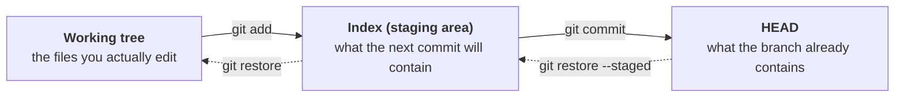

# Lab 2 — Reviewing & Undoing Before You Commit

Not everything you type is meant to be kept. This lab is about catching mistakes before they become part of your history: discarding an edit, unstaging a file, and keeping local-only files out of git entirely. Along the way you'll see _why_ each undo command works, which is what lets you pick the right one under pressure.

Do this from your `sample-training-repo` clone, on `main` (where Lab 1 left you) or any other branch. Nothing here needs to be pushed, and you'll undo every edit before the end.

> **Starting here?** This lab needs the sample repo cloned. Run `dojo prep 2` to set that up; it's safe to run even if you did the earlier labs.

---

## In this lab

| Command                       | What it does                                                |
| ----------------------------- | ----------------------------------------------------------- |
| `git diff`                    | Show unstaged changes: working tree compared with the index |
| `git restore <file>`          | Discard uncommitted edits: copy index to working tree       |
| `git diff --staged`           | Show staged changes: index compared with HEAD               |
| `git restore --staged <file>` | Unstage a file but keep the edit: copy HEAD to index        |
| `.gitignore`                  | A file of patterns that tells git to ignore untracked files |
| `git check-ignore -v <file>`  | Show which rule is ignoring a file                          |

You'll meet each one when you need it, and the "Your turn" steps expect you to pick the right one from here.

---

## The idea: three places your work can live

Every "undo" in git is really "copy this file from one place to another", so first know the places:



Solid arrows move work forward. Dotted arrows are the two ways of stepping back, which is what the rest of this lab is about.

- The **working tree** is the files on disk, the ones your editor opens.
- The **index** (also called the staging area) is a draft of your next commit. `git add` copies a file from the working tree into it.
- **HEAD** is the commit you're sitting on. Commits are permanent and can't be changed by accident.

Keep that picture in mind. Each command below moves a file one step along the arrows, or back.

---

## 1. Make an edit you don't want

When you edit a file, the change lands in one place only: the **working tree**. The index and HEAD still hold the version you last committed, and git hasn't been told anything yet. Two commands let you look at that state:

- `git status` lists which files differ from what git has.
- `git diff` shows exactly what changed: the working tree compared with the index.

Suppose you then decide the edit was a mistake and you want the file back exactly as it was. Git's tool for this is **`git restore`**. It copies a file from one place into another, overwriting what was there. With no options it copies **from the index into the working tree**, which means "put this file back the way git has it".

```text
git restore <file>
```

**This is destructive.** An edit that was only ever in the working tree was never a commit or a staged blob, so there is nothing to recover it from. _Use it only when you're sure._

Now try it. Open `roster/team.yaml` in your editor and add a line you'd regret: a throwaway entry at the bottom, such as `- name: Test Entry`. Save the file, but don't stage or commit it. This is the same kind of edit you made in Lab 1, only this time you're going to throw it away.

**Prefer the terminal?**

```sh
# Appends the same line. The edit is what matters, not how you made it.
echo "- name: Test Entry" >> roster/team.yaml
```

**Your turn:**

You've changed a file but told git nothing. Before you run anything, predict what `git status` and `git diff` will say about it. Then run both and see whether you were right.

```sh
git status
git diff
```

<!-- dojo-reveal: Results of git status and git diff -->

- `git status` lists `roster/team.yaml` as modified.
- `git diff` shows the `Test Entry` line as added.

<!-- /dojo-reveal -->

Right now the index and HEAD are identical, so this edit exists in **one place only**: the working tree.

**Your turn:** use `git restore` on `roster/team.yaml`, then confirm. Before you run it, predict:

- which of the three places gets overwritten?
- what happens to your `Test Entry` line?

```sh
git restore roster/team.yaml
git status
bat roster/team.yaml
```

The working tree is the place that gets overwritten. Because nothing was staged, the index still held the committed version, so your file snaps back, the `Test Entry` line is gone, and `git status` is clean.

---

## 2. Stage something, then change your mind

`git add` copies a file from the working tree into the index, the draft of your next commit. After that the edit lives in **two places**, and the two diffs split the work between them:

- `git diff` compares the working tree to the index. Once you stage a change, the two match and it shows **nothing**.
- `git diff --staged` compares the index to HEAD, so it now shows the change.

Staging and committing are separate decisions, and staging is only the first. If you change your mind, you want the file **out of the next commit** but your edit kept on disk. `git restore` can do that too, with a flag that changes its destination:

```text
git restore --staged <file>
```

`--staged` makes it write into the **index** instead of the working tree, copying from **HEAD**. It resets the draft of your next commit for that file and never touches the file on disk.

The two forms are easy to mix up:

| Command                       | Copies from | Copies to    | Your edit |
| ----------------------------- | ----------- | ------------ | --------- |
| `git restore <file>`          | index       | working tree | **lost**  |
| `git restore --staged <file>` | HEAD        | index        | kept      |

Now try it. Open `roster/team.yaml` in your editor again, add another throwaway line such as `- name: Another Test`, and save.

**Prefer the terminal?**

```sh
echo "- name: Another Test" >> roster/team.yaml
```

Stage the change:

```sh
git add roster/team.yaml
```

**Your turn:**

Before you run anything, predict which of `git diff` and `git diff --staged` will show your new line and which will be empty. Then check:

```sh
git status
git diff
git diff --staged
```

`git status` shows the file under "Changes to be committed", `git diff` is empty and `git diff --staged` shows the change.

**Your turn:** now unstage `roster/team.yaml`. Before you run it, predict:

- what will `git diff` and `git diff --staged` show afterwards?
- is the `Another Test` line still in the file?

```sh
git restore --staged roster/team.yaml
git status
git diff
git diff --staged
bat roster/team.yaml
```

- `git status` lists the file as "not staged for commit" again.
- `git diff` shows the `Another Test` line: the edit is still in your working tree.
- `git diff --staged` is now empty: the index matches HEAD again.

Clean up before moving on:

```sh
git restore roster/team.yaml
```

**Check yourself:** if you stage an edit with `git add`, then edit the same file again, which of the three places hold which version? What would `git restore <file>` throw away now?

<!-- dojo-reveal: Show the answer -->

All three differ: HEAD has the committed version, the index has the first edit, and the working tree has the first edit plus the second. `git restore <file>` copies from the index, so it discards only the **second** edit and leaves the staged first one in place. `git status` will list the file twice, once staged and once not staged, which is how you can tell.
<!-- /dojo-reveal -->

---

## 3. Keep local-only files out of git

Not every file that shows up in `git status` should be committed: build output, editor settings, local secrets. `.gitignore` is how you tell git to leave them alone.

A `.gitignore` is a plain text file, usually at the top of the repo, with one pattern per line. Git treats any untracked file that matches a pattern as if it didn't exist:

```text
# a comment goes on its own line
*.log
build/
.env
!keep.log
```

`*.log` matches any file ending in `.log`, `build/` matches a whole directory, `.env` matches one specific file, and a leading `!` makes an exception to an earlier rule.

A few things worth knowing:

- Patterns are matched relative to the folder holding the `.gitignore`, and one in a subfolder applies to that folder and below.
- The `.gitignore` file is committed like any other, so the whole team shares the same rules. For personal rules that shouldn't be shared (your editor's temp files, say), use `.git/info/exclude`, which works the same way but is never committed.
- Ignored files stay on disk. Git just stops listing them and stops `git add .` from sweeping them in by accident, which is the most common way secrets and junk end up in a repo.

Create a file that shouldn't be committed:

```sh
touch scratch.log
git status
```

`scratch.log` shows up as untracked.

**Your turn:** make git ignore every `.log` file. Create a `.gitignore` file in the repo root with the line `*.log` in your editor, then run `git status`. Before you do, predict what `git status` will list instead of `scratch.log`.

**Prefer the terminal?**

```sh
echo "*.log" >> .gitignore
```

```sh
git status
git check-ignore -v scratch.log
```

- `scratch.log` has disappeared from the untracked list.
- `.gitignore` itself now appears as a new untracked file. That's correct: the rule is a file in the repo, and you'd commit it so that everyone who clones gets the same rule.
- `git check-ignore -v scratch.log` prints the file and line of the rule that matched, which is how you see _why_ a file is ignored.

Clean up (this is a throwaway exercise, not something to commit):

```sh
rm scratch.log .gitignore
git status
```

**Check yourself:** a teammate committed `config.env` last week, then added `config.env` to `.gitignore`. It's still showing as modified when they edit it. Why, and does the `.gitignore` entry protect the secret inside?

<!-- dojo-reveal: Show the answer -->

`.gitignore` only affects **untracked** files. Once a file has been committed, git tracks it and keeps reporting changes regardless of the ignore rule. To stop tracking it you'd run `git rm --cached config.env` and commit that, and the file stays on disk.

That still doesn't protect the secret: it remains in every earlier commit, which anyone who cloned the repo already has. If a secret was ever committed, treat it as exposed and rotate it. Adding it to `.gitignore` afterwards is not a fix.
<!-- /dojo-reveal -->

---

## Recap

- Files live in three places: the **working tree**, the **index**, and **HEAD**. `git add` moves a change from the first to the second, and `git commit` from the second to the third.
- `git diff` compares working tree to index; `git diff --staged` compares index to HEAD.
- `git restore <file>` — copies index to working tree: discards uncommitted edits.
- `git restore --staged <file>` — copies HEAD to index: unstages, keeping your edit.
- `.gitignore` — keeps new, untracked files out of `git status` and `git add .`; it does nothing for files already committed.

**Next:** [lab3.md](lab3.md) — stashing, for when you need to switch branches mid-edit.
