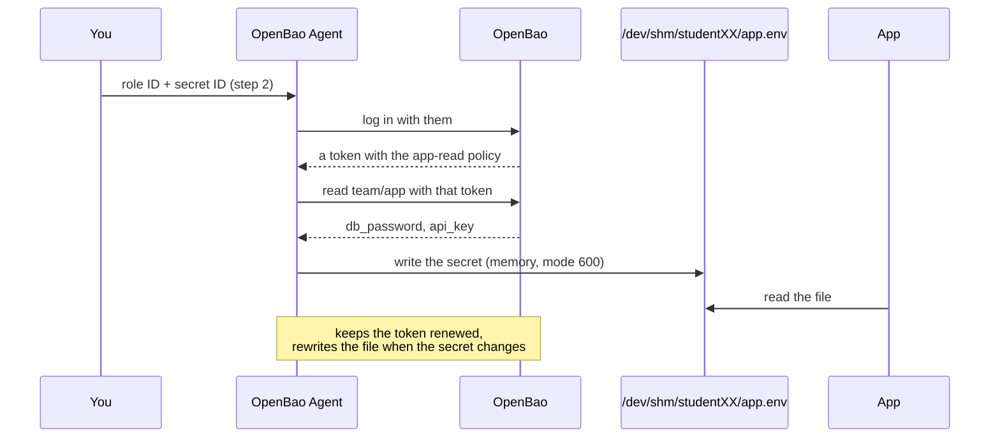

# Lab 6 — OpenBao Agent

**Goal:** give the app an identity of its own and let **OpenBao Agent** do the vault work: it logs in, keeps the token fresh and writes the secret to a file only the app can read, in memory. Rotate the secret and the app picks it up without a commit or a restart.

The app itself stops talking to the vault at all. It reads a file.

**In this lab you will:**

1. Get back into your namespace, where Lab 4's `team/app` secret and `app-read` policy are.
2. Give the app a login of its own with **AppRole**, and hand it its two IDs.
3. Write the Agent's config, and start the Agent.
4. Look at the file the Agent wrote, and where it wrote it.
5. Run an app that only reads that file.
6. Rotate the secret, and watch the app pick it up live.
7. See the Agent renew its token, then clean up.



---

## 1. Back in your namespace

This lab uses what you built in Lab 4. If you skipped it, this block makes it; if you didn't, it changes nothing that matters. It's a **catch-up** block: several of the later labs start with one, so you can run them in any order. Each line does something only if it's missing (`||` means "if the left side failed, run the right side"). The last line is Lab 4's `app-read.hcl` in one line: `printf` writes the policy, and `-` tells `bao policy write` to read it from the pipe instead of a file.

**Your turn:** run it. Nothing here should print an error.

```bash
export BAO_NAMESPACE=students/$USER
bao secrets list | grep -q '^team/' || bao secrets enable -path=team kv-v2
# a new KV mount refuses writes for a moment while it upgrades: retry
until echo '{"db_password": "app-db-pass", "api_key": "app-api-key"}' | bao kv put team/app -; do sleep 2; done
printf 'path "team/data/app" {\n  capabilities = ["read"]\n}\n' | bao policy write app-read -
```

## 2. An identity for the app: AppRole

**AppRole** is a sign-in method for programs. The app gets a **role ID** (like a user name) and a **secret ID** (like a password), and signing in with both gives it a token with the role's policies.

You turn AppRole on in your namespace, then make a role called `app`. (A `\` at the end of a line means "the command carries on on the next line".) What the role says:

- `token_policies=app-read`: a login gets Lab 4's policy, so it can read `team/app` and nothing else.
- `token_ttl=2m`, `token_max_ttl=10m`: each token lives two minutes unless renewed, and ten minutes at most. It's short, so you'll see the Agent renew one during this lab.
- `secret_id_ttl=1h`: a secret ID stops working after an hour.

Then you play the part of whoever deploys the app, and hand it its two IDs as files. The first command reads the role's ID; the second makes a new secret ID (`-f` because the request has no data). `>` writes each command's output to a file, and `chmod 600` makes both files readable by you only.

```text
bao auth enable approle
bao write auth/approle/role/<name> token_policies=<policy> ...
bao read -field=role_id auth/approle/role/<name>/role-id
```

**Your turn:** run these. Before you do, predict what files you'll end up with.

```sh
bao auth enable approle
bao write auth/approle/role/app \
    token_policies=app-read token_ttl=2m token_max_ttl=10m secret_id_ttl=1h
mkdir -p ~/lab/agent && cd ~/lab/agent
bao read -field=role_id auth/approle/role/app/role-id > role-id
bao write -f -field=secret_id auth/approle/role/app/secret-id > secret-id
chmod 600 role-id secret-id
```

<!-- dojo-reveal: Result of setting up the role -->

Two small files, `role-id` and `secret-id`, readable by you only. You'll see them in VS Code under **agent**; don't open `secret-id`, treat it as a password.

<!-- /dojo-reveal -->


Look at what just happened: to let the app log in without a secret in its code, you gave it... a secret. That's the **secret zero** problem. Here it's small (a secret ID that expires in an hour and that the Agent deletes as soon as it has read it), but something still had to deliver it. Labs 9 and 11 remove it by using an identity the platform already proves.

## 3. Configure the Agent

The Agent is part of `bao` (`bao agent`). Its config file says three things: which vault, how to log in, and which secrets to write to which files. Block by block:

- **`vault`**: where the vault is.
- **`auto_auth`**: log in with AppRole, in your namespace, using the two files from step 2. `remove_secret_id_file_after_reading` deletes the secret ID once it's used. The Agent then renews the token, and logs in again when it has to.
- **`template_config`**: how often to check the secret for changes.
- **`template`**: which file to write (`destination`), readable by you only (`perms`), and what goes in it. `{{ with secret "team/data/app" }}` reads the secret; `{{ .Data.data.db_password }}` is one of its values. The file comes out as two `NAME=value` lines, like Lab 5's `.env`.

The secret will go to `/dev/shm`, which is memory (`tmpfs`), not disk. Make a folder there that only you can open (`install -d -m 700`: a directory, mode 700):

```sh
install -d -m 700 /dev/shm/$USER
```

Open VS Code and create **agent → `agent.hcl`**. It needs your user name in two places, because a config file can't read `$USER`. The lab page in your browser fills it in below; if you see student**XX** instead, replace it with yours:

```hcl
vault {
  address = "http://openbao:8200"
}

# Log in with AppRole in your namespace, then keep the token alive.
auto_auth {
  method "approle" {
    namespace = "students/studentXX"
    config = {
      role_id_file_path                   = "role-id"
      secret_id_file_path                 = "secret-id"
      remove_secret_id_file_after_reading = true
    }
  }
}

# Check the secret for changes every 5 seconds (the default is 5 minutes).
template_config {
  static_secret_render_interval = "5s"
}

template {
  destination = "/dev/shm/studentXX/app.env"
  perms       = "0600"
  contents    = <<-EOT
  {{ with secret "team/data/app" }}DB_PASSWORD={{ .Data.data.db_password }}
  API_KEY={{ .Data.data.api_key }}{{ end }}
  EOT
}
```

Save it. The `&` on the Agent command runs it in the **background**, so you get your prompt back; `> agent.log 2>&1` sends everything it prints to `agent.log`.

**Your turn:** check your name is in both places, start the Agent, and after three seconds look for the two lines that say it worked. Predict what you'll see.

```sh
grep -n "$USER" agent.hcl      # the namespace line and the destination line
bao agent -config=agent.hcl > agent.log 2>&1 &
sleep 3
grep -E 'authentication successful|rendered' agent.log
```

<!-- dojo-reveal: Result of starting the Agent -->

Two lines: one for `authentication successful`, one for the template `rendered`.

<!-- /dojo-reveal -->

Nothing? Open `agent.log` in VS Code: the error is usually a typo in `agent.hcl`, or the wrong user name in it.

## 4. What the Agent wrote

The Agent wrote the secret to a file in memory, with mode 600, and deleted the secret ID after reading it.

**Your turn:** look at the file and where it lives. Before you run these, predict: what filesystem type is `/dev/shm`, and is `secret-id` still in your folder?

```sh
ls -l /dev/shm/$USER/        # -rw------- you: nobody else can read it
df -h /dev/shm | tail -1     # tmpfs: memory, gone when the machine stops
cat /dev/shm/$USER/app.env
ls                           # secret-id is gone: read once, then deleted
```

<!-- dojo-reveal: Results of looking at the rendered file -->

The file is `-rw-------`, `/dev/shm` is `tmpfs`, `app.env` holds the two `NAME=value` lines, and `secret-id` is gone.

<!-- /dojo-reveal -->

The secret never touched the disk, only its owner can read it, and the secret ID can't be stolen from the disk later because it isn't there any more.

## 5. The app reads a file

This app knows nothing about vaults. Every three seconds it reads the Agent's file and prints a **fingerprint** of the password: the first 8 characters of its SHA-256 hash. The fingerprint changes when the password changes, but can't be turned back into it, so it's safe to print (Lab 5: never the password itself).

In VS Code, create **agent → `app.py`** and add:

```python
import hashlib
import os
import time

path = f"/dev/shm/{os.environ['USER']}/app.env"
while True:
    with open(path) as f:
        conf = dict(line.split("=", 1) for line in f.read().split())
    fingerprint = hashlib.sha256(conf["DB_PASSWORD"].encode()).hexdigest()[:8]
    print(time.strftime("%H:%M:%S"), "database password fingerprint", fingerprint, flush=True)
    time.sleep(3)
```

Save it. Open a second terminal next to the first one: the **split** icon at the top right of VS Code's terminal (or `Ctrl+b %` in the plain Terminal's tmux).

**Your turn:** run the app in the second terminal and leave it running. Predict what it prints every three seconds.

```sh
cd ~/lab/agent && python3 app.py
```

<!-- dojo-reveal: Result of the app -->

A time and the same 8-character fingerprint, every three seconds.

<!-- /dojo-reveal -->


## 6. Rotate it, live

Rotating means changing the secret in the vault only. `$(date +%s)` puts the current time in seconds into the new value, so it's different every time.

**Your turn:** back in the first terminal, rotate the password. Before you do, predict how long until the app's output changes.

```sh
printf '%s' "rotated-$(date +%s)" | bao kv patch team/app db_password=-
```

<!-- dojo-reveal: Result of the rotation -->

Within about 5 seconds the fingerprint in the app's terminal changes. No commit, no new build, no restart, and nobody had to tell the app.

<!-- /dojo-reveal -->

A real app would reload when the file changes, or the Agent can run a command after each render (`command` in the `template` block) to signal it.

## 7. The Agent keeps the token alive

The app's token lives two minutes.

**Your turn:** after a couple of minutes, look at the Agent's log. Predict what you'll find.

```sh
grep -iE 'renew' agent.log | tail -3
```

<!-- dojo-reveal: Result of the log check -->

Renewal lines. The Agent renews the token as it goes, and logs in again when it reaches its maximum TTL (10 minutes). The app never sees a token at all.

<!-- /dojo-reveal -->

## 8. Clean up

Stop the app (**Ctrl+C** in its terminal), then, in the first terminal, stop the Agent and remove the rendered file. `%1` is the shell's name for the first background job, the Agent:

```bash
kill %1                  # the Agent (or: pkill -u $USER -f 'bao agent')
rm -rf /dev/shm/$USER
unset BAO_NAMESPACE
```

## Check yourself

1. What did the app need to know about the vault?

<!-- dojo-reveal: Show the answer -->

Nothing. It reads a file; the Agent logs in, renews and renders.

<!-- /dojo-reveal -->

2. What is this app's secret zero, and what limits the damage if it leaks?

<!-- dojo-reveal: Show the answer -->

The secret ID. It expires in an hour, the Agent deletes it after reading, and the token it gets can read one secret.

<!-- /dojo-reveal -->

3. Why `/dev/shm` and `0600`?

<!-- dojo-reveal: Show the answer -->

Memory, not disk: nothing left behind after a stop or in a backup. Only the app's user can read it.

<!-- /dojo-reveal -->


**Rules used:** 4 (know your secret zero), 3 (short-lived tokens, renewed for you), 7 (rotation is routine), 8 (never on disk).

**Next:** [lab7.md](lab7.md)
